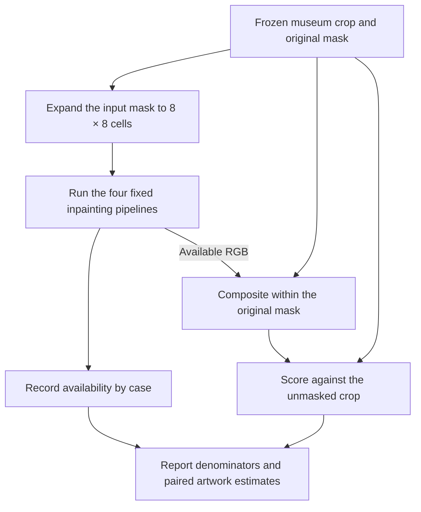

# Reconstruction Fidelity and Output Coverage of Four Inpainting Models on Museum Painting Crops

*Working manuscript*

## Abstract

<!-- evidence -->
Digital inpainting can propose fills for painting losses, but fidelity to missing content is difficult to establish without a reference. We compared four fixed inpainting models on unresized 512-pixel crops from 120 open-access paintings at two museums, balanced across four medium and support groups. We applied six procedural loss conditions to each crop and scored the original masked pixels against the recorded image. On complete paired works, MAT exceeded LaMa in masked mean absolute error by 0.0022 in Cleveland and 0.0032 in Chicago. The corresponding SDXL gaps were 0.2690 and 0.2480. In Cleveland, an alternative SDXL configuration with ring-color prefill reduced its mean error from 0.3015 to 0.1114, with a remaining 0.0789 gap to LaMa. PowerPaint returned scorable outputs for 281 of 360 planned conditions in Cleveland and 350 of 360 in Chicago. A restricted replay of Cleveland's withheld conditions recovered the missing outputs and preserved the mean error ranking. These results separate image fidelity from output coverage under controlled digital losses.

*Keywords* · image inpainting · digital painting restoration · museum digitizations · full-reference evaluation

## 1. Introduction

<!-- opening -->
Digital inpainting can propose fills for losses in digitized paintings. Once original material is lost, the historical colors and marks in the missing region are usually unavailable for direct comparison. For a controlled assessment of fidelity, the same image can supply both the concealed region and its recorded reference. This type of comparison addresses one part of a broader conservation workflow in which additions should be documented, detectable, and reversible. [American Institute for Conservation, §23](https://community.culturalheritage.org/conservation-at-work/uphold-professional-standards/code) · [Kachkine, 2025](https://doi.org/10.1038/s41586-025-09045-4)

<!-- challenge -->
Painting inpainting has already been evaluated on simulated losses. Imagest compared its style-conditioned system with several baselines on 100 artworks processed at 256 × 256 pixels and reported aggregate full-reference scores. Controlled-300 compared multiple restoration pipelines in visual-content groups and reported favorable masked error for LaMa in its matched cases. We ask whether four fixed inpainting systems show similar performance across painting media and supports when both the input aperture and the evaluation area are controlled. An additional question concerns how often a system returns an output eligible for scoring. [Hu et al., 2025](https://www.nature.com/articles/s40494-025-02167-y?error=cookies_not_supported) · [Maddineni, 2026, research archive](https://zenodo.org/records/23092185)

<!-- method -->
We compare LaMa, MAT, PowerPaint v1, and SDXL Inpainting on unresized 512-pixel crops from two museum collections. We use the same three procedural mask families at two area fractions, group paintings by medium and support, and estimate paired differences at the artwork level within each museum. A shared input aperture controls access to nearby pixels. Separate output counts identify which results remain available after PowerPaint's safety screening. Targeted sensitivity analyses examine the choice of aperture, SDXL settings, and the PowerPaint conditions withheld in Cleveland.

## 2. Materials and methods

### 2.1. Museum cohorts and image preparation

<!-- method -->
Each collection contributed 15 works in each of four groups: oil on canvas, oil on wood support, watercolor on paper, and ink on paper. The Cleveland Museum of Art cohort consisted of 60 CC0 digitizations at the museum's full-size rendition, including 16 artworks used in the native-pixel pilot. The Art Institute of Chicago cohort was sampled independently from a frozen catalog export. Within each group, we sorted candidate IDs by the SHA-256 of a fixed seed, group name, and object ID. We selected the first 15 eligible objects, allowing one work per identifiable primary artist within each group and checking for repeated objects and images. Eligibility required a current public-domain designation, a matching primary-image identifier, compatible catalog medium and support, and a decodable official rendition of suitable size. The Chicago images were the museum's 1686-pixel-wide IIIF JPEGs. [Cleveland open access](https://www.clevelandart.org/open-access) · [Chicago open access](https://www.artic.edu/open-access/open-access-images) · [Chicago catalog and sampling](AIC_REPLICATION.md)

Each work contributed one 512 × 512 crop sampled from its oriented source using a fixed pseudorandom position. We transformed embedded color profiles to sRGB when present and stored 8-bit RGB crops. The three mask families represented a crack, scattered flakes, or contiguous loss. Each covered approximately 1% or 5% of the pixels. We reused the six masks for a given within-group position across groups and museums. Crop positions, artwork identifiers, and mask hashes were frozen before inference. [Frozen design](INNOVATION.md#pr-11-复审后的原尺度主实验) · [Mask and crop code](../experiments/patch_design.py)

### 2.2. Input aperture and model settings

<!-- advantage -->
An input mask downsampled onto the diffusion latent grid can lose narrow sections of a crack or flake. We expanded the original scoring mask to include each 8 × 8 cell intersecting the hole. Every model in the main comparison received the expanded binary mask and an image with this area set to black. Each delivered image used the generated pixels within the original mask and the original pixels elsewhere. The original-mask input sensitivity gave LaMa and MAT the smaller mask and retained the same compositing rule. [Mask alignment analysis](LATENT_ALIGNMENT.md) · [Implementation](../experiments/latent_aligned.py)

**Figure 1.** The shared aperture controls the visible input. The original mask defines the retained generated region, and the case status defines eligibility for paired scoring.

<!-- method -->
We used the fixed LaMa TorchScript release, a Places MAT checkpoint in the IOPaint release with its noise path disabled, PowerPaint v1 with context prompts, and the SDXL Inpainting 0.1 checkpoint. The two diffusion pipelines used a single generic painting-restoration instruction and the same budget of 25 requested steps, classifier-free guidance of 7.5, and strength 1.0 in the main comparison. PowerPaint appended its context token and used its object token as the negative prompt. We used a single fixed seed, 2026, and one RTX 3090. The main PowerPaint arms kept the base pipeline's safety checker enabled. A withheld image remained in the planned denominator and contributed no reconstruction score. Running the same seed a second time checked for transient execution failures. [LaMa](https://doi.org/10.1109/WACV51458.2022.00323) · [MAT](https://doi.org/10.1109/CVPR52688.2022.01049) · [PowerPaint](https://doi.org/10.1007/978-3-031-73636-0_12) · [SDXL Inpainting model card](https://huggingface.co/diffusers/stable-diffusion-xl-1.0-inpainting-0.1/blob/115134f363124c53c7d878647567d04daf26e41e/README.md) · [Model adapters](DECISIONS.md)

### 2.3. Outcomes and comparison units

<!-- method -->
The primary outcome was the mean absolute difference between corresponding RGB values inside the original mask, divided by 255. We computed CIEDE2000 (ΔE₀₀) both as a mean of masked pixel-pair differences and as a difference between the two masked mean CIELAB colors under D65 and the CIE 1931 2° observer. The latter measures net color displacement. LPIPS with AlexNet v0.1 and DISTS used the mask's bounding box with an eight-pixel margin clipped to the crop boundary. These are full-reference distances. Smaller values indicate closer agreement with the recorded crop. [Luo et al., 2001](https://doi.org/10.1002/col.1049) · [Zhang et al., 2018](https://doi.org/10.1109/CVPR.2018.00068) · [Ding et al., 2022](https://doi.org/10.1109/TPAMI.2020.3045810)

Overall estimates gave equal weight to the six conditions within an artwork and then to each artwork with all six conditions available for that comparison. Individual mask-condition estimates used its available matched works. The four-model tables have a common denominator within each museum. Each pairwise estimate uses all works complete for the two models in that pair. We used 10,000 artwork-level bootstrap resamples for unadjusted 95% percentile intervals. The project specified practical difference margins of 0.01 for masked MAE and 0.02 for local LPIPS. Comparisons by medium and individual damage condition are descriptive. [Analysis protocol](INNOVATION.md#预先固定的判定规则) · [Pairing implementation](../experiments/analyze_followup.py)

### 2.4. Sensitivity and output audits

<!-- method -->
In Cleveland, we repeated all 360 SDXL conditions at strength 0.99, guidance 8, and 20 requested steps. We initialized the expanded hole with the rounded per-channel sRGB mean of the eight-pixel ring immediately outside it. The masked conditioning used the same hole. We also drew 12 conditions without replacement for a visual inspection of saved original, LaMa, and SDXL crops. The inspection documented examples. All comparative scores were computed automatically. [Cleveland review protocol and audit](NATIVE_REVIEW.md)

Two attempts in the main Cleveland run recorded safety exclusions for the same 79 PowerPaint conditions. We replayed each previously withheld condition once with the safety checker disabled and retained the original successful predictions for the other 281 conditions. This conditional replay provided a mixed 60-work sensitivity analysis. Chicago used the main configurations and the original-aperture sensitivity for LaMa and MAT. [Frozen review and replication design](INNOVATION.md#pr-13-复审后的核查与复现实验)

## 3. Results

### 3.1. The same masked-error ordering appeared in both collections

<!-- evidence -->
LaMa had the lowest mean masked MAE in each museum's four-model evaluation. That ordering was followed by MAT, PowerPaint, and SDXL in both cohorts (Table 1). In the two-model analysis, MAT and LaMa had six paired conditions on all 60 works in each museum. The intervals for both their MAE and LPIPS differences lay inside the prespecified practical margins in both collections (Table 2). [Cleveland main results](NATIVE_MAIN.md) · [Chicago replication](AIC_REPLICATION.md)

**Table 1.** Mean reconstruction distances with the shared expanded input. The four models are evaluated on 41 complete works in Cleveland (246 conditions) and 54 in Chicago (324 conditions). Lower values indicate closer agreement.

| Collection and complete works | Model | Masked MAE ↓ | Local LPIPS ↓ | Pixel-pair mean ΔE₀₀ ↓ | ΔE₀₀ of mean Lab ↓ | Local DISTS ↓ |
| --- | --- | ---: | ---: | ---: | ---: | ---: |
| Cleveland, 41 | LaMa | 0.0315 | 0.0643 | 3.7305 | 0.7947 | 0.0491 |
| Cleveland, 41 | MAT | 0.0339 | 0.0761 | 3.9414 | 0.7154 | 0.0542 |
| Cleveland, 41 | PowerPaint v1 | 0.0581 | 0.1696 | 6.2781 | 3.5030 | 0.1417 |
| Cleveland, 41 | SDXL | 0.3076 | 0.4930 | 31.9019 | 30.5106 | 0.3391 |
| Chicago, 54 | LaMa | 0.0387 | 0.0685 | 4.1787 | 0.9272 | 0.0570 |
| Chicago, 54 | MAT | 0.0421 | 0.0773 | 4.4747 | 0.9173 | 0.0595 |
| Chicago, 54 | PowerPaint v1 | 0.0650 | 0.1482 | 6.9000 | 3.1668 | 0.1234 |
| Chicago, 54 | SDXL | 0.2709 | 0.4181 | 28.2618 | 26.4494 | 0.2906 |

**Table 2.** Artwork-level paired comparisons with LaMa. Differences are candidate minus LaMa, with unadjusted 95% percentile intervals in brackets.

| Collection | Candidate | Complete works | Masked MAE difference | Local LPIPS difference |
| --- | --- | ---: | ---: | ---: |
| Cleveland | MAT | 60 | +0.0022 [0.0015, 0.0030] | +0.0102 [0.0070, 0.0135] |
| Cleveland | PowerPaint v1 | 41 | +0.0266 [0.0203, 0.0337] | +0.1053 [0.0800, 0.1333] |
| Cleveland | SDXL | 60 | +0.2690 [0.2203, 0.3186] | +0.4258 [0.3893, 0.4623] |
| Chicago | MAT | 60 | +0.0032 [0.0023, 0.0041] | +0.0088 [0.0066, 0.0110] |
| Chicago | PowerPaint v1 | 54 | +0.0263 [0.0221, 0.0310] | +0.0797 [0.0625, 0.0990] |
| Chicago | SDXL | 60 | +0.2480 [0.2035, 0.2956] | +0.3695 [0.3304, 0.4104] |

The SDXL–LaMa MAE difference was positive in all four groups in each museum, with wide variation in some group-specific intervals. For example, the difference was smaller in watercolor than in oil on canvas by 0.1303 MAE in Cleveland, with an interval from −0.2562 to −0.0039 for the watercolor-minus-canvas contrast. The corresponding Chicago contrast was −0.0228 [−0.1303, 0.0877]. The shared ranking replicated. The size of the individual group contrasts was less stable. [Per-group and per-condition results](NATIVE_MAIN.md#共享遮挡的主结果) · [Replication contrasts](AIC_REPLICATION.md#可用率与主比较)

With original-mask input, LaMa and MAT had lower masked errors in both museums. Expanding the input aperture increased LaMa's MAE by 0.0040 in Cleveland and 0.0058 in Chicago. The increases for MAT were 0.0055 and 0.0081. The four-model MAE rankings persisted with the smaller input masks for these two models. [Cleveland aperture sensitivity](NATIVE_MAIN.md#原掩码输入敏感性) · [Chicago aperture sensitivity](AIC_REPLICATION.md#敏感性与运行核验)

### 3.2. An alternative SDXL configuration reduced the fidelity gap

<!-- evidence -->
In the Cleveland sensitivity, the alternative SDXL settings reduced MAE by 0.1901 [0.1460, 0.2354] across 60 works. Local LPIPS declined from 0.4920 to 0.3816, and ΔE₀₀ between the mean Lab colors declined from 30.0251 to 8.5715. The remaining MAE difference was +0.0789 [0.0714, 0.0870] relative to LaMa and +0.0767 [0.0691, 0.0850] relative to MAT. [Paired sensitivity results](NATIVE_REVIEW.md#sdxl-环带均色缩小差距)

The sampled SDXL main outputs included bright streaks in dark areas, smooth blocks in textured regions, and straight or triangular forms absent from the recorded crops. Two sampled outputs were reproduced pixel-for-pixel using the pinned pipeline and seed. One Cleveland crop was fully black in the museum rendition. Excluding that work in an exploratory check yielded SDXL–LaMa MAE differences of +0.2597 for the main settings and +0.0776 for the alternative settings. [Saved-output audit](NATIVE_REVIEW.md#sdxl-抽样核查)

### 3.3. PowerPaint output coverage differed between museums

<!-- evidence -->
PowerPaint with its safety checker returned scorable outputs for 281 of 360 Cleveland conditions (78.1%) and 350 of 360 Chicago conditions (97.2%). Its Cleveland coverage was lowest in oil on canvas, at 55 of 90 conditions. It returned 87 of 90 oil-on-canvas conditions in Chicago. Full-work availability for the four-model comparison was 41 of 60 works in Cleveland and 54 of 60 in Chicago. Descriptions of Cleveland's affected source artworks included people, animals, and landscapes. The source descriptions concern entire works, while the checker evaluated generated outputs. [Cleveland coverage and catalog audit](NATIVE_REVIEW.md#powerpaint-安全拦截) · [Chicago coverage by group](AIC_REPLICATION.md#可用率与主比较)

The restricted Cleveland replay returned 79 of 79 previously withheld outputs. Averaged across the 19 affected works, the replayed conditions gave PowerPaint a masked MAE of 0.0714 and a paired difference of +0.0369 [0.0190, 0.0583] relative to LaMa. Combining the replayed outputs with the 281 successful safety-on outputs gave PowerPaint an MAE of 0.0604 on the complete cohort, with a paired difference of +0.0279 [0.0211, 0.0357] relative to LaMa. The complete-cohort ranking by MAE remained LaMa, MAT, PowerPaint, then SDXL. [Conditional replay and mixed-denominator comparison](NATIVE_REVIEW.md#powerpaint-安全拦截)

## 4. Discussion

<!-- advantage -->
The close overall agreement of LaMa and MAT and the higher SDXL errors persisted across collections despite a change in image rendition and artwork composition. The SDXL comparison also shows why reporting an explicit initialization matters. The more favorable setting combination substantially reduced both a pixel error and a local perceptual distance, while the resulting estimates remained above those of the two non-diffusion baselines. Strength, guidance, step count, and prefill changed together in this 60-work comparison. A previous smaller experiment varied prefill on its own and motivates the ring-color choice. [Earlier prefill study](SDXL_PREFILL.md)

The PowerPaint results show why fidelity scores benefit from an attached coverage denominator. A comparison restricted to available outputs refers to a subset determined by the pipeline. That subset was substantially smaller in Cleveland. The conditional replay addresses the ranking's dependence on these particular missing outputs. A wider investigation of safety behavior would require outcomes and classifications available in a design intended for that question.

<!-- limitation -->
The benchmark covers three procedural mask families at two area fractions on 512-pixel digital crops, with one inference seed per condition. The model results apply to the pinned weights, prompts, and adaptations, including 512-pixel SDXL inference. The physical area represented by a 512-pixel crop can vary across works and museum renditions. Medium and support groups can also differ in subject, date, imaging, and composition. The frozen samples retained one Cleveland crop with constant black RGB and one Chicago watercolor on paper tipped onto card. Separate exclusion checks preserved the reported directions. Automatic full-reference distances quantify fidelity to the recorded image under synthetic masking. Authentic loss shapes and treatment decisions require their own evidence. [Cleveland crop audit](NATIVE_REVIEW.md#sdxl-抽样核查) · [Chicago eligibility sensitivity](AIC_REPLICATION.md#敏感性与运行核验)

## 5. Conclusion

For the tested setups, the two museum cohorts support the same overall MAE ranking and a small difference between LaMa and MAT. The magnitude of SDXL's fidelity gap depended strongly on the initialization and inference settings. PowerPaint's output coverage differed across cohorts even though the same safety settings were used. A reproducible comparison of inpainting on painting digitizations therefore benefits from recording the visible input, the scored region, and the outputs available for comparison.

## Code and data availability

The repository contains the frozen sampling and analysis protocol, code, and result tables with artifact hashes. The images come from the museums' open-access collections. Frozen source files, per-condition scores, model outputs, and manifests are retained in the experiment archive. [Run instructions](ARCHITECTURE.md) · [Cleveland evidence](NATIVE_REVIEW.md) · [Chicago evidence](AIC_REPLICATION.md)

## References

- Suvorov, R. et al. (2022). Resolution-Robust Large Mask Inpainting with Fourier Convolutions. *IEEE/CVF WACV*. [DOI](https://doi.org/10.1109/WACV51458.2022.00323)
- Li, W. et al. (2022). MAT: Mask-Aware Transformer for Large Hole Image Inpainting. *IEEE/CVF CVPR*. [DOI](https://doi.org/10.1109/CVPR52688.2022.01049)
- Zhuang, J., Zeng, Y., Liu, W., Yuan, C. & Chen, K. (2025). A Task Is Worth One Word: Learning with Task Prompts for High-Quality Versatile Image Inpainting. *Computer Vision – ECCV 2024*, LNCS 15116, 195–211. [DOI](https://doi.org/10.1007/978-3-031-73636-0_12)
- Diffusers Team (2023). *SD-XL Inpainting 0.1*. Model card, revision `115134f363124c53c7d878647567d04daf26e41e`. [Archived version](https://huggingface.co/diffusers/stable-diffusion-xl-1.0-inpainting-0.1/blob/115134f363124c53c7d878647567d04daf26e41e/README.md)
- Luo, M. R., Cui, G. & Rigg, B. (2001). The development of the CIE 2000 colour-difference formula: CIEDE2000. *Color Research & Application*, 26(5), 340–350. [DOI](https://doi.org/10.1002/col.1049)
- Zhang, R., Isola, P., Efros, A. A., Shechtman, E. & Wang, O. (2018). The Unreasonable Effectiveness of Deep Features as a Perceptual Metric. *IEEE/CVF CVPR*, 586–595. [DOI](https://doi.org/10.1109/CVPR.2018.00068)
- Ding, K., Ma, K., Wang, S. & Simoncelli, E. P. (2022). Image Quality Assessment: Unifying Structure and Texture Similarity. *IEEE Transactions on Pattern Analysis and Machine Intelligence*, 44(5), 2567–2581. [DOI](https://doi.org/10.1109/TPAMI.2020.3045810)
- Kachkine, A. (2025). Physical restoration of a painting with a digitally constructed mask. *Nature*, 642, 343–350. [DOI](https://doi.org/10.1038/s41586-025-09045-4)
- Hu, J., Zhou, P., Gao, J., Zhang, Y., Geng, G. & Zhou, M. (2025). Imagest: a style conditioned art painting synthesis and generation networks. *npj Heritage Science*, 13, 613. [Article](https://www.nature.com/articles/s40494-025-02167-y?error=cookies_not_supported)
- Maddineni, R. (2026). *Trustworthy Evaluation Frameworks for AI-Assisted Painting Restoration: Controlled-300 Research Artifacts*. Zenodo research archive, version 1.0.0. [Record](https://zenodo.org/records/23092185)
- American Institute for Conservation (1994). *Code of Ethics and Guidelines for Practice*, §23, Compensation for Loss. [Official guidance](https://community.culturalheritage.org/conservation-at-work/uphold-professional-standards/code)

## 写作交接

提纲从馆藏补失缺少直接真值出发。

- 用有真值的程序遮挡衡量固定模型配置下的重建忠实度。
- 用相同模型输入范围区分模型误差与样本可用率。
- 通过同作品配对和独立馆藏比较总体排序、组内差值和分母。
- 用 SDXL 设置、像素模型输入范围及 PowerPaint 缺失输出的敏感性约束解释。
- 将实体补失及真实形状来源保留为独立研究问题。

| 论点 | 证据 | 状态 |
| --- | --- | --- |
| 两馆在固定四模型配置下的掩码内 MAE 排序一致 | 表 1、表 2及两馆报告的逐模型配对 | 支持 |
| MAT 与 LaMa 的总体差值在预定实用幅度内 | 表 2 的 60 幅配对和两个指标的区间 | 支持 |
| SDXL 替代设置缩小误差，剩余差值高于预定幅度 | §3.2 的 360 个配对条件 | 支持，限克利夫兰 |
| PowerPaint 可用率随馆藏改变，补齐原拦截后克利夫兰 MAE 排序维持 | §3.3 的计划分母和 79 个限定重放 | 支持 |
| 画材差异的幅度可跨馆迁移 | §3.1 的组间区间 | 证据不足，正文仅作描述 |
| 真实破损或实体修复中的可靠性 | [真实形状供体核查](../literature/audit-of-claude-v1.md#artefact-样本与许可) | 需新证据 |

初稿自查覆盖各段主题、分母、指标方向和同时改变的参数。独立馆藏只执行了已固定主设置及原掩码敏感性。组间结果按描述性证据解读。定性核查用于追踪个案，比较结果使用自动评分。章节和图表按通用学术论文格式组织。
