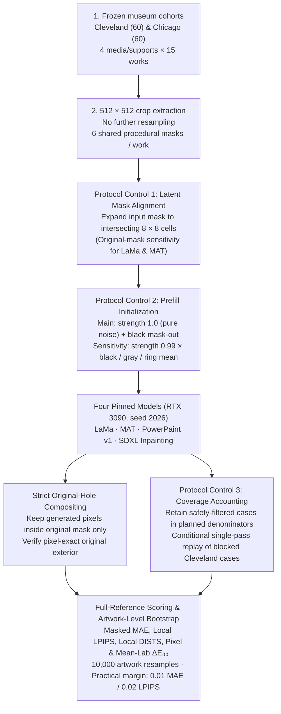

# Protocol Choices Strongly Affect Measured Fidelity in Painting Inpainting, While Model Rankings Hold Across Museums and Media

*Manuscript draft v2*

## Abstract

Full-reference evaluations of off-the-shelf image inpainting models on digitized paintings are sensitive to three pipeline details that govern what a model actually sees and which cases are scored: how binary masks are downsampled onto diffusion latent grids, how masked holes are prefilled prior to denoising, and how safety-filtered outputs are counted. We quantify the impact of these three protocol choices and benchmark four pinned models—LaMa, MAT, PowerPaint v1, and SDXL Inpainting—on 120 open-access paintings from the Cleveland Museum of Art and the Art Institute of Chicago, balanced across four medium-and-support groups (oil on canvas, oil on wood, watercolor on paper, and ink on paper) and six procedural loss conditions (cracks, scattered flakes, and contiguous losses at 1% and 5% area) using 512 × 512 crops taken without further resampling from each museum's published rendition. The tested nearest-neighbor latent downsampling leaves 53%–56% of masked pixels uncovered on 1% cracks and flakes; expanding the input mask to cover all intersecting 8 × 8 pixel blocks reduces PowerPaint v1 masked mean absolute error (MAE) by 43.5% (0.0974 to 0.0550) in the 16-work native-scale pilot. At `strength = 0.99`, changing only the hole prefill color from black to mid-gray or an 8-pixel surrounding ring mean shifts SDXL MAE from 0.1513 to 0.1302 and 0.0981 (0.2342 to 0.1777 and 0.1618 on 60 center-masked works) and reverses luminance bias from −0.0847 to +0.0339; across all 60 Cleveland works, pairing ring-color prefill with the model-card settings cuts SDXL MAE from 0.3015 to 0.1114. PowerPaint's built-in safety checker withholds 21.9% of Cleveland conditions (79/360; 38.9% in oil on canvas) versus 2.8% in Chicago (10/360). The replayed Cleveland conditions had higher mean error than the six-condition-complete safety-on works. Once all three protocol factors are controlled, the four-model masked-MAE ordering is identical on matched cases across both museums, all four painting media and supports, and all six damage conditions: LaMa and MAT perform within the prespecified 0.01 MAE practical margin of each other (MAT minus LaMa: +0.0022 in Cleveland, +0.0032 in Chicago), followed by PowerPaint v1 and SDXL. For localized losses in these cohorts, the choice among the tested models was consistent across painting media; for benchmark designers, reporting latent mask alignment, prefill initialization, and coverage denominators is essential for reproducible comparison.

*Keywords*: image inpainting · digital painting restoration · evaluation protocols · museum digitizations · full-reference metrics · latent diffusion

---

## 1. Introduction

Digital image inpainting offers a fast way to visualize plausible completions for losses in digitized paintings, from fine craquelure and paint flaking to broad lacunae. In cultural heritage contexts, however, visual plausibility alone is insufficient. Conservation ethics treat loss compensation as a reversible, detectable, and documented intervention grounded in respect for original material [@icomcc2008; @aic1994], a principle recently demonstrated in physical practice through reversible digitally printed masks [@kachkine2025]. When digital inpainting is used to support documentation, visualization, or restoration planning, the central technical question is reconstruction fidelity: how closely a model recovers missing local color, brushwork, and structure rather than inventing plausible but unfaithful content. Because authentic historical losses lack surviving ground truth, controlled evaluation relies on masking intact museum digitizations and scoring predicted pixels directly against the recorded artwork using automatic full-reference distances.

Existing painting-inpainting studies have compared neural models under simulated or transferred losses, yet three low-level protocol choices in modern evaluation pipelines can change the comparison. First, the tested SDXL Inpainting and PowerPaint pipelines downsample pixel-space binary masks by a factor of eight using nearest-neighbor interpolation [@diffuserssdxl0352; @zhuang2023]. The 8-pixel grid can omit narrow structures from explicit mask conditioning, a broader concern in latent-space inpainting [@shamsolmoali2025tdpaint]. In this study, subsampling removed over half of the intended hole pixels on 1% cracks and flakes. Second, when SDXL runs with denoising strength below 1.0, as demonstrated by the model card’s 0.99 example [@sdxlinpaint], the pipeline encodes the pre-masked input image into the initial noisy latent [@diffuserssdxl0352]. The ground-truth hole pixels are erased before encoding, and the chosen replacement color can affect the generated luminance and error, a sensitivity discussed in Diffusers development [@diffusers8450]. Third, bundled safety checkers can withhold generated outputs. Evaluating fidelity only on returned images compares models on different, pipeline-selected subsets whose composition can vary dramatically across museum collections. Alongside these protocol gaps, prior multi-model benchmarks either aggregate across heterogeneous artworks [@hu2025imagest] or stratify by visual subject such as portraits and landscapes [@controlled300], leaving practitioners uncertain whether model rankings shift across distinct physical media and supports such as oil on canvas, oil on wood, watercolor on paper, and ink on paper.

In this study, we quantify the effects of all three protocol choices and evaluate four fixed off-the-shelf inpainting models—two non-diffusion architectures (LaMa [@suvorov2021] and MAT [@li2022mat]) and two latent diffusion models (PowerPaint v1 [@zhuang2023] and SDXL Inpainting [@sdxlinpaint])—under a preregistered, cross-museum protocol (Figure 1). Using 120 open-access paintings equally balanced across four medium-and-support groups from the Cleveland Museum of Art (60 works) and an independently sampled replication cohort from the Art Institute of Chicago (60 works), we extract 512 × 512 crops taken without further resampling from each museum's published rendition and apply six shared procedural loss conditions spanning cracks, scattered flakes, and contiguous losses at 1% and 5% area fractions. We quantify the consequences of grid alignment and its larger input aperture through paired before-and-after experiments, isolate prefill color through a univariate three-color comparison (black, mid-gray, and surrounding ring mean), and assess a full-cohort SDXL sensitivity arm. We characterize safety-filter coverage through planned-denominator tracking and a conditional replay of all withheld Cleveland cases.

Across 2,880 planned main conditions and 1,440 original-mask sensitivity conditions spanning both museums—supplemented by targeted diagnostic, prefill, and replay arms—our experiments establish four main contributions:

1. **Quantification of latent-space mask under-coverage in painting evaluation.** We show that nearest-neighbor 8× downsampling omits 53%–56% of target pixels on 1% cracks and flakes; aligning input masks to intersecting 8 × 8 latent cells eliminates missed pixels and reduces PowerPaint v1 masked MAE by 43.5% in the native-scale pilot (from 0.0974 to 0.0550, with reductions of −0.1252 on 1% cracks and −0.1553 on 1% flakes).
2. **Quantification of prefill color sensitivity under `strength < 1.0`.** We show that changing only the hole prefill color at `strength = 0.99` shifts SDXL masked MAE by 0.0532–0.0725—five to seven times our 0.01 practical margin—and flips signed luminance bias from negative (black prefill) to positive (mid-gray and ring mean). Pairing ring-color prefill with the model-card parameters across all 60 Cleveland works reduces SDXL MAE from 0.3015 to 0.1114, yet leaves a +0.0789 gap above LaMa.
3. **Quantification of cohort-dependent safety-filter withholding.** We show that PowerPaint v1 withholds 21.9% of planned conditions in Cleveland (up to 38.9% in oil on canvas) but only 2.8% in Chicago under identical settings. The 79 replayed Cleveland conditions had a larger mean MAE gap to LaMa than the six-condition-complete safety-on works (+0.0369 vs. +0.0266), illustrating why coverage denominators must accompany fidelity scores.
4. **Cross-museum, cross-medium invariance of model rankings.** Once these three protocol choices are controlled, the four-model masked-MAE ordering—LaMa < MAT < PowerPaint v1 < SDXL—holds on four-model matched cases in both museums, in all four medium-and-support strata, and across all six damage conditions. The overall LaMa–MAT differences fall within 0.01 MAE and 0.02 LPIPS, and the magnitude of between-group contrasts differs across collections.

---

## 2. Related Work

### 2.1 General-purpose image inpainting pipelines

Classical inpainting formulated hole filling as local continuation from known image boundaries, propagating isophotes via partial differential equations [@bertalmio2000] or copying best-matching patches by structure-prioritized exemplar synthesis [@criminisi2004]. Deep learning shifted inpainting toward learned global priors, beginning with context encoders combining reconstruction and adversarial losses [@pathak2016] and extending to arbitrary hole geometries via partial convolutions [@liu2018] and gated convolutions [@yu2018]. To bridge wide gaps at higher resolutions, subsequent non-diffusion architectures introduced co-modulated generative adversarial networks [@zhao2021], fast Fourier convolutions with image-wide receptive fields in LaMa [@suvorov2021], and mask-aware transformer attention in MAT [@li2022mat]. Because LaMa and MAT operate directly on pixel-grid inputs without text conditioning or content filters, they serve as strong, deterministic non-diffusion baselines for local continuation.

A second paradigm performs conditional generation inside the compressed latent space of an autoencoder [@rombach2021] or via iterative diffusion resampling [@lugmayr2022]. Widely adopted open checkpoints include SDXL Inpainting 0.1, which was trained at a 1024 × 1024 image resolution and conditions its UNet on mask and masked-image channels [@sdxlinpaint]; PowerPaint v1, which adds learnable task prompts to separate context-aware filling from object insertion and removal [@zhuang2023]; dual-branch architectures such as BrushNet [@ju2024]; and large rectified-flow transformers such as FLUX.1 Fill [@fluxfill]. Moving inpainting into latent space introduces three operational factors largely absent from pixel-space networks: spatial quantization of fine masks onto an 8× downsampled latent grid, coupling between pre-masked RGB inputs and initial noisy latents whenever `strength < 1.0`, and safety filters bundled with public pipelines. Our study directly measures how these three implementation details affect full-reference fidelity and sample availability on digitized paintings.

### 2.2 Digital painting restoration, damage modeling, and benchmarks

Early computational restoration studies demonstrated virtual crack detection and inpainting on masterworks such as the Ghent Altarpiece while noting the absence of surviving ground truth for real damage [@cornelis2013]. Subsequent work paired domain-specific models with cultural heritage datasets, including Dunhuang mural benchmarks using random-walk or real-damage masks [@yu2019dunhuang; @shao2023; @xu2024dunhuang], deep image prior formulations for frescoes and style-coherent filling [@merizzi2024; @morotti2024], dual-encoder networks for ancient Chinese paintings [@sun2024], super-resolution and textile restoration pipelines [@hu2024; @wang2024silk], fine-tuned diffusion for frescoes [@smolka2025], and synthetic craquelure generation [@cuchguillen2026]. In parallel, pixel-level damage segmentation datasets such as ARTeFACT catalog real analogue damage across heritage media [@ivanova2024artefact], while several restoration papers transplant real damage silhouettes onto intact Chinese paintings [@zhang2026inkrenew; @xue2025]. Creative painterly editing frameworks that insert new objects or text-guided content into artworks pursue a different goal from conservation-oriented reconstruction [@xu2023refpaint; @fanelli2024].

Four recent benchmarks are closest to our multi-model evaluation. Cipolina-Kun et al. compared CoModGAN, LaMa, and GLIDE on transformations of a single Escher lithograph plus a qualitative fresco example [@cipolinakun2022], leaving multi-artwork and cross-medium generalization untested. Imagest benchmarked a style-conditioned generator against VQGAN, Stable Diffusion 1.4/1.5, and DALL·E 2 on 100 artificially damaged paintings cropped or resized to 256 × 256 pixels, reporting aggregate full-reference metrics without stratifying by medium or support [@hu2025imagest]. MDTD-ArtIR evaluated blind restoration and editing models on 1,000 WikiArt paintings degraded by semi-transparent texture overlays rather than binary missing-region masks [@vijendran2026]. Most closely, Controlled-300—an unreviewed Zenodo master's research archive [@controlled300]—compared Telea, LaMa, HINT, and Stable Diffusion across 300 paintings grouped by visual content (portraits, landscapes, architecture, abstract, and high texture) and included a 35-work fixed-area mask robustness check, reporting low masked MAE for LaMa. Relative to these precedents, our work quantifies latent-grid mask coverage, prefill initialization, and safety-filter denominators, stratifies explicitly by physical medium and support rather than visual genre, and tests replication across two independent museum open-access collections without downsampling museum renditions into uniform 256-pixel thumbnails.

### 2.3 Full-reference evaluation metrics and conservation ethics

Evaluating restoration automatically requires distinguishing pixel-level distortion from perceptual or structural similarity, a tension formalized at the distribution level by the perception–distortion tradeoff [@blau2018]. Pixelwise RGB error (MAE) directly measures local numeric agreement, while CIEDE2000 (`ΔE₀₀`) captures perceptually weighted color differences and net color shifts in CIELAB space [@luo2001ciede2000; @sharma2005ciede2000]. Learned full-reference metrics extend comparison to mid- and high-level representations: LPIPS aligns with human pairwise similarity judgments [@zhang2018lpips], whereas DISTS unifies structure and texture similarity with partial tolerance to stochastic texture resampling [@ding2020dists]. More recent work targets semantic hallucination specifically, including masked CLIP and boundary-gradient scores in MISATO [@wang2025misato], high-level fidelity proxies in super-resolution [@rocafort2025], controllable hallucination testing in HalluGen [@kim2026hallugen], and discussions of iconographic hallucination in mural restoration [@ren2026mapgr].

Conservation charters establish why transparent, auditable protocols matter even in purely digital evaluations. The 2008 ICOM-CC terminology resolution defines restoration as actions undertaken with respect for original material [@icomcc2008], and Section 23 of the AIC Guidelines for Practice requires compensation for loss to be documented, detectable by common examination methods, and reversible [@aic1994]. Translating these norms to a computational benchmark motivates preserving exact unmasked original pixels outside the scoring hole, recording immutable hashes of inputs, masks, and outputs, and reporting all excluded or safety-filtered cases alongside full-reference scores rather than silently discarding failures.

---

## 3. Materials and Methods

### 3.1 Study overview and preregistered workflow

To separate genuine architectural differences from evaluation artifacts, we built a modular, preregistered benchmark pipeline (Figure 1). Every experimental stage—the initial center-masked pilot, the native-scale pilot and latent-alignment correction, the SDXL parameter and univariate prefill studies, the 60-work Cleveland main cohort, the Cleveland sensitivity and replay audit, and the 60-work Chicago replication—was covered by a version-controlled protocol specified before GPU inference. The reported run windows and artifact SHA-256 hashes support verification where recorded. All results in this study characterize reconstruction fidelity and output availability for the pinned off-the-shelf model checkpoints, prompts, single-seed main inference settings, and 512-pixel procedural loss protocols described below.

**Figure 1.** Main two-museum workflow. Frozen crops and scoring masks are retained separately from the shared 8 × 8 expanded model input. The four fixed models are compared on paired scores after original-hole compositing, with output coverage recorded against all planned conditions. Publication files: `figure-1-workflow.pdf` and `figure-1-workflow.png` in the server-side figure manifest.

### 3.2 Museum cohorts, sampling, and crop preparation

We assembled two independent open-access painting cohorts, each comprising 60 artworks evenly stratified into four physical medium-and-support groups (15 works per group): oil on canvas, oil on wood support, watercolor on paper, and ink on paper.

**Cleveland Museum of Art (CMA) cohort.** All 60 works were drawn from Cleveland's CC0 open-access collection using the museum's full-size downloadable image renditions [@cma-openaccess]. One catalog record initially flagged as a painting (`cma-121867`) was excluded prior to model inference after catalog verification identified it as a wooden door. Within each group, catalog IDs were deterministically permuted with NumPy PCG64 (seed `20261119`). Sixteen works (positions 0–3 per group) overlapped with our earlier native-scale pilot; 15 retained pixel-identical crops, while `cma-173965` was upgraded from an alternate rendition to the museum's full-size file. Post-hoc crop inspection revealed that one frozen crop (*The Trinity*, coordinate `(5145, 503)` in the full-size TIFF) had constant black RGB `(0, 0, 0)` across all pixels; following our preregistered rule against post-selection replacement, it was retained in the main cohort and examined in an exploratory exclusion check.

**Art Institute of Chicago (AIC) independent replication cohort.** To test whether findings generalize beyond Cleveland and its 16-work pilot overlap, we drew an independent 60-work cohort from a frozen AIC public-domain catalog export [@aic-openaccess]. Eligible candidates required a public-domain designation, a valid primary IIIF image identifier, a published short edge of at least 640 pixels, an aspect ratio of at most 2.8, and verified medium-and-support metadata, yielding 801 oil-on-canvas, 236 oil-on-wood, 97 watercolor-on-paper, and 35 ink-on-paper candidates. Within each group, candidates were deterministically ordered by `SHA-256("20261121|group|object_id")` and audited sequentially until 15 eligible works from distinct identifiable primary artists were acquired. Across 84 audited candidates, 12 were skipped due to duplicate within-group artists, 11 were skipped because requests for the museum's 1686-pixel-wide IIIF JPEG redirected to 843-pixel files, and 1 failed the image-dimension check. All 60 acquired Chicago images are official 1686-pixel-wide IIIF JPEGs with no exact source image or crop hash matches in Cleveland. One watercolor (`aic-114337`) is painted on paper subsequently mounted onto card; it was retained under the frozen catalog filter and checked in a separate exclusion analysis.

**Crop extraction and procedural damage masks.** After EXIF orientation correction and conversion of embedded ICC color profiles to sRGB, we extracted one 8-bit RGB 512 × 512 crop per artwork at a fixed pseudorandom integer coordinate, taken without further resampling from each museum's published rendition. Each crop received six procedural binary masks crossing three damage morphologies—a thin tortuous connected crack, dispersed small paint flakes, and a single contiguous irregular loss—with two target area fractions (1% and 5% of the 512 × 512 crop, rounded to the nearest pixel, yielding 2,621 and 13,107 masked pixels), totaling 360 planned conditions per museum. The six masks assigned to within-group rank positions 0–14 were identical across all four medium-and-support groups and identical between Cleveland and Chicago (verified by mask SHA-256 hashes), ensuring exact geometric matching across strata and collections.

### 3.3 Pinned models and the three controlled protocol experiments

We evaluated four publicly released inpainting models on a single NVIDIA RTX 3090 (24 GiB VRAM) using fixed seed `2026` in all main runs:

- **LaMa** [@suvorov2021]: IOPaint TorchScript release (SHA-256 verified), standard 512-pixel inference without iterative refinement.
- **MAT** [@li2022mat]: IOPaint Places-512 state dictionary (`truncation_psi = 1`) with the explicit decoder noise path disabled because the released checkpoint omits `noise_const` and `noise_strength` buffers; per-condition latent sampling was seeded deterministically.
- **PowerPaint v1** [@zhuang2023]: pinned author implementation and weights (Diffusers 0.27.0 environment), DDIM scheduler, 512 resolution, 25 inference steps, classifier-free guidance (CFG) 7.5, `strength = 1.0`, positive context task token (`P_ctxt`) paired with a single generic painting-restoration prompt, and negative object token (`P_obj`). The bundled safety checker remained enabled in all main arms.
- **SDXL Inpainting 0.1** [@sdxlinpaint]: pinned Diffusers 0.35.2 checkpoint (revision `115134f363124c53c7d878647567d04daf26e41e`), 9-channel UNet, EulerDiscreteScheduler, verified FP16 AutoencoderKL (`force_upcast = false`), 512 resolution, the same generic painting-restoration prompt, 25 requested steps, CFG 7.5, and `strength = 1.0` in the main comparison.

We also pre-screened FLUX.1 Fill [dev] [@fluxfill] as a fifth candidate; full BF16 parameter storage alone requires at least 31.43 GiB (exceeding our 24 GiB GPU without separate quantization or CPU offloading) and anonymous downloads of the gated checkpoint returned HTTP 401, so it was not executed.

**Protocol Control 1: Latent-space mask alignment and shared input aperture.** Both SDXL Inpainting and PowerPaint downsample the binary input mask by 8× via nearest-neighbor interpolation onto a 64 × 64 latent grid at 512-pixel inference (and effectively stride 4 relative to the 512 scoring grid when upsampled to 1024). To measure this distortion, we first audited 796 unaligned pilot outputs (from the 60-work center-masked pilot and the 16-work native-scale pilot) by replaying exact nearest-neighbor downsampling and computing pixel coverage, masked MAE, and Rec. 709 luminance separately inside covered versus missed hole pixels. We then enforced a shared latent-aligned aperture across all models: any 8 × 8 cell intersecting the original scoring mask was marked as masked in the model input, and all pixels inside this expanded mask were zeroed (black) prior to inference in the main arms. Crucially, final compositing placed generated pixels strictly inside the original unexpanded scoring mask and preserved exact original pixels everywhere outside (verified pixel-for-pixel across every saved PNG). To verify that giving pixel-space models a larger masked hole did not distort rankings, we ran original-mask input sensitivity arms for LaMa and MAT in both Cleveland and Chicago (720 additional runs per museum).

**Protocol Control 2: Prefill initialization and SDXL parameter sensitivity.** In Diffusers' SDXL Inpainting pipeline, the input image travels through two paths. The `masked_image` conditioning branch zeros masked pixels in normalized `[-1, 1]` space (mid-gray). However, when `strength < 1.0` (such as the model card's recommended `strength = 0.99`, CFG 8.0, 20 requested steps, which yields 19 effective denoising steps starting at `t = 901` with noise scale `σ ≈ 8.391`), the pipeline encodes the full pre-masked `image` through the VAE and initializes the latent as `z_img + σ·ε`. At the first UNet step, Euler input scaling `1 / √(1 + σ²)` assigns the encoded input latent a weight of approximately `0.118`. Because original ground-truth pixels must be erased before VAE encoding to prevent data leakage, the hole prefill color can affect the generated output through the initialized latent.

To isolate prefill color as a single variable, we fixed SDXL at 512 resolution, `strength = 0.99`, CFG 8.0, 20 requested steps, and seed `2026`, varying only the RGB color placed inside the expanded input hole across three arms: black (RGB 0), mid-gray (RGB 128), and an 8-pixel surrounding ring mean (the single per-image rounded per-channel sRGB mean of all visible pixels within an 8-pixel square neighborhood strictly outside the expanded mask). This univariate three-color test ran on both the 60 center-masked works (5% irregular central hole, 180 outputs) and the 16 native-scale pilot works (96 conditions per color, 288 outputs). We then scaled the strongest configuration (`0.99 / 8.0 / 20` + ring-color prefill) to all 360 Cleveland main conditions to test whether favorable SDXL initialization closes the gap to non-diffusion baselines. Additional single-seed sensitivities on the 60 center-masked works tested 1024-pixel inference and an empty text prompt. Finally, we audited 12 randomly sampled Cleveland SDXL main cases (NumPy PCG64 seed `20261121`, without replacement) via three-column contact sheets (original, LaMa, SDXL) and reproduced two sampled cases pixel-for-pixel and independently checked the SHA-256 hash of the VAE weights.

**Protocol Control 3: Safety-filter denominators and conditional replay.** Whenever PowerPaint's built-in safety checker flagged an output, the run was repeated once with the identical seed and inputs to check for transient runtime errors; persistent flags were recorded as withheld cases rather than scored as black images, and retained in the planned denominator. To assess the sensitivity of the four-model comparison to Cleveland's 79 withheld conditions (19 works), we conducted a catalog subject audit of the 19 source paintings and executed a single-pass conditional replay of exactly those 79 conditions with the safety checker disabled (identical crops, masks, seed, and parameters). We evaluated both the 79-condition replayed subset and the combined 60-work / 360-condition mixed cohort alongside the primary safety-on cohort.

### 3.4 Metrics and statistical analysis

Our primary fidelity metric is **masked MAE**: the mean absolute RGB difference between the reconstructed and original crops computed strictly over pixels inside the original unexpanded mask, divided by 255 to lie on `[0, 1]`. To capture chromatic accuracy, perceptual similarity, and texture/structure preservation without human raters, we computed four secondary full-reference metrics:

1. **Pixel-pair mean CIEDE2000 (`ΔE₀₀`)** inside the original mask (D65 illuminant, CIE 1931 2° observer) [@luo2001ciede2000; @sharma2005ciede2000].
2. **CIEDE2000 of masked mean CIELAB colors**, measuring net overall color displacement across the filled hole.
3. **Local LPIPS** (AlexNet v0.1) [@zhang2018lpips] computed on the original mask's tight bounding box padded by an 8-pixel context margin (clipped to the 512 × 512 boundary).
4. **Local DISTS** [@ding2020dists] computed on the same padded bounding box.

For diagnostic and prefill experiments, we additionally computed **signed luminance bias**: the mean difference (output minus reference) in Rec. 709 weighted sRGB luminance `[0, 1]` inside the original mask, where negative values indicate darkening and positive values indicate brightening. For all distance metrics, lower values indicate closer agreement with the recorded artwork.

Within each museum, overall artwork-level scores weighted the six damage conditions equally and included only artworks with all six conditions available for the comparison at hand. Four-model summary tables therefore use the common complete-work denominator (41/60 in Cleveland, 54/60 in Chicago), whereas pairwise comparisons against LaMa retain every artwork complete for that specific model pair (60/60 for MAT and SDXL in both museums; 41 and 54 for PowerPaint). Per-condition summaries include all artworks complete across all four models for that condition. Uncertainty was estimated by 10,000 artwork-level cluster bootstrap resamples, yielding unadjusted 95% percentile confidence intervals. Before running the main experiments, we prespecified practical equivalence/selection margins of **0.01 masked MAE** (roughly 2.55 gray levels per 8-bit channel) and **0.02 local LPIPS**; medium-and-support contrasts and per-condition breakdowns are interpreted descriptively.

---

## 4. Results

### 4.1 Model rankings replicate identically across both museum collections

Once latent mask alignment, initialization, and coverage denominators are controlled, all four models follow the exact same fidelity ordering in both Cleveland and Chicago by masked MAE, local LPIPS, pixel-pair `ΔE₀₀`, and DISTS: **LaMa < MAT < PowerPaint v1 < SDXL** (Table 1). MAT scored slightly lower than LaMa on mean-Lab `ΔE₀₀` in both collections. On complete four-model cohorts, LaMa achieved a masked MAE of 0.0315 in Cleveland (41 complete works, 246 conditions) and 0.0387 in Chicago (54 complete works, 324 conditions), closely trailed by MAT at 0.0339 and 0.0421. PowerPaint v1 increased masked MAE (0.0581 and 0.0650) and more than doubled local LPIPS and DISTS relative to LaMa, while SDXL under the main `strength = 1.0` configuration produced substantially larger errors across all five metrics (MAE 0.3076 in Cleveland, 0.2709 in Chicago; mean-Lab `ΔE₀₀` exceeding 26 in both collections). Figure 2 illustrates three reconstructions across crack, flake, and contiguous-loss conditions.

**Table 1.** Mean full-reference reconstruction distances under the shared 8 × 8 expanded input aperture, evaluated strictly inside the original scoring mask (or its 8-pixel padded bounding box for LPIPS and DISTS). Complete four-model denominators comprise 41 works (246 conditions) in Cleveland and 54 works (324 conditions) in Chicago. Lower values indicate closer fidelity (↓).

| Collection (complete works) | Model | Masked MAE ↓ | Local LPIPS ↓ | Pixel-pair mean ΔE₀₀ ↓ | Mean-Lab ΔE₀₀ ↓ | Local DISTS ↓ |
| --- | --- | ---: | ---: | ---: | ---: | ---: |
| Cleveland (n = 41) | LaMa | 0.0315 | 0.0643 | 3.7305 | 0.7947 | 0.0491 |
| Cleveland (n = 41) | MAT | 0.0339 | 0.0761 | 3.9414 | 0.7154 | 0.0542 |
| Cleveland (n = 41) | PowerPaint v1 | 0.0581 | 0.1696 | 6.2781 | 3.5030 | 0.1417 |
| Cleveland (n = 41) | SDXL (main) | 0.3076 | 0.4930 | 31.9019 | 30.5106 | 0.3391 |
| Chicago (n = 54) | LaMa | 0.0387 | 0.0685 | 4.1787 | 0.9272 | 0.0570 |
| Chicago (n = 54) | MAT | 0.0421 | 0.0773 | 4.4747 | 0.9173 | 0.0595 |
| Chicago (n = 54) | PowerPaint v1 | 0.0650 | 0.1482 | 6.9000 | 3.1668 | 0.1234 |
| Chicago (n = 54) | SDXL (main) | 0.2709 | 0.4181 | 28.2618 | 26.4494 | 0.2906 |

Artwork-level paired comparisons against LaMa confirm both the practical equivalence of the two non-diffusion models and the magnitude of the diffusion gaps (Table 2). Across all 60 works in each museum, MAT exceeded LaMa by +0.0022 [0.0015, 0.0030] MAE in Cleveland and +0.0032 [0.0023, 0.0041] in Chicago; the corresponding local LPIPS differences (+0.0102 [0.0070, 0.0135] and +0.0088 [0.0066, 0.0110]) likewise remained entirely inside our prespecified 0.01 MAE and 0.02 LPIPS practical margins. By contrast, PowerPaint v1 exceeded LaMa by +0.0266 [0.0203, 0.0337] MAE in Cleveland and +0.0263 [0.0221, 0.0310] in Chicago, and SDXL exceeded LaMa by +0.2690 [0.2203, 0.3186] and +0.2480 [0.2035, 0.2956].

**Table 2.** Artwork-level paired differences relative to LaMa (candidate minus LaMa) with unadjusted 95% bootstrap percentile intervals (10,000 artwork resamples). Positive values favor LaMa.

| Collection | Candidate model | Complete works | Masked MAE difference [95% CI] | Local LPIPS difference [95% CI] |
| --- | --- | ---: | ---: | ---: |
| Cleveland | MAT | 60 | +0.0022 [0.0015, 0.0030] | +0.0102 [0.0070, 0.0135] |
| Cleveland | PowerPaint v1 | 41 | +0.0266 [0.0203, 0.0337] | +0.1053 [0.0800, 0.1333] |
| Cleveland | SDXL (main) | 60 | +0.2690 [0.2203, 0.3186] | +0.4258 [0.3893, 0.4623] |
| Chicago | MAT | 60 | +0.0032 [0.0023, 0.0041] | +0.0088 [0.0066, 0.0110] |
| Chicago | PowerPaint v1 | 54 | +0.0263 [0.0221, 0.0310] | +0.0797 [0.0625, 0.0990] |
| Chicago | SDXL (main) | 60 | +0.2480 [0.2035, 0.2956] | +0.3695 [0.3304, 0.4104] |

The planned aperture sensitivity and exploratory edge-case exclusions preserved the main findings. Across all 60 paired works per museum, giving LaMa and MAT the original unexpanded mask reduced masked MAE by 0.0040 [0.0033, 0.0047] and 0.0055 [0.0046, 0.0064], respectively, in Cleveland, and by 0.0058 [0.0047, 0.0070] and 0.0081 [0.0066, 0.0097] in Chicago. On common complete works, the corresponding LaMa and MAT original-aperture means were 0.0276 and 0.0285 in Cleveland (41 works) and 0.0325 and 0.0334 in Chicago (54 works), preserving the four-model masked-MAE ordering. Excluding Cleveland's uniformly black crop (*The Trinity*, n = 59) yielded virtually identical SDXL minus LaMa MAE differences (+0.2597 [0.2137, 0.3065] under main settings; +0.0776 [0.0704, 0.0852] under ring-prefill sensitivity), and excluding Chicago's card-mounted watercolor (`aic-114337`) yielded MAE differences vs. LaMa of +0.0031 (MAT, n = 59), +0.0265 (PowerPaint, n = 53), and +0.2480 (SDXL, n = 59).

> Publication files: `figure-2-examples.pdf` and `figure-2-examples.png`. See the server-side `figure-manifest.json` for source and file checksums.
> **Figure 2.** Deterministically selected 5% crack, flake, and contiguous-loss examples from three distinct CC0 Cleveland artworks with outputs from all four models. Each row shows the same square detail in the reference crop, binary scoring mask, and outputs from LaMa, MAT, PowerPaint v1, and SDXL Inpainting at the main settings. Generated pixels appear only within the original mask; case identifiers and artwork credits are in the figure manifest.

### 4.2 Latent-space mask under-coverage omits over half of thin losses and changes diffusion error

Auditing our unaligned pilot outputs revealed that nearest-neighbor 8× mask downsampling systematically dropped a large fraction of narrow loss geometries (Table 3; Figure 3). At 512-pixel inference, 55.96%–56.29% of original hole pixels in 1% cracks and 53.14% in 1% flakes never entered the diffusion conditioning mask. Even at 5% area fraction, roughly one quarter of crack (24.67%–25.20%) and flake (25.36%–25.43%) pixels were missed, compared with 14.05%–14.29% for 1% contiguous losses, 6.39%–6.40% for 5% contiguous losses, and 7.19% for the compact 5% center-masked pilot (3.12% at 1024 resolution).

**Table 3.** Protocol Factor 1: Latent-space mask under-coverage under default 8× nearest-neighbor downsampling (512-pixel inference), input-area expansion ratios required to guarantee zero missed hole pixels, and paired before-versus-after masked MAE shifts on the 16-work native-scale pilot (seed 2026). Row counts are matched works for that condition. PowerPaint v1 had 84 paired conditions in total, of which the 72 conditions on 12 complete works entered the work-level overall mean. SDXL had 96 paired conditions across 16 complete works.

| Procedural condition | Missed hole pixels, SDXL / PowerPaint | Stride-8 expanded / original area ratio | PowerPaint MAE change (aligned − unaligned) [95% CI] | SDXL MAE change (aligned − unaligned) [95% CI] |
| --- | ---: | ---: | ---: | ---: |
| Crack 1% | 55.96% / 56.29% | 2.539 | −0.1252 [−0.1931, −0.0614] (n = 14) | −0.1085 [−0.1498, −0.0703] (n = 16) |
| Crack 5% | 25.20% / 24.67% | 1.594 | +0.0138 [−0.0023, 0.0329] (n = 14) | −0.0587 [−0.0877, −0.0323] (n = 16) |
| Flake 1% | 53.14% / 53.14% | 2.948 | −0.1553 [−0.1999, −0.1132] (n = 15) | −0.0868 [−0.1188, −0.0580] (n = 16) |
| Flake 5% | 25.43% / 25.36% | 1.727 | +0.0037 [−0.0054, 0.0132] (n = 13) | +0.0670 [0.0398, 0.0966] (n = 16) |
| Contiguous loss 1% | 14.05% / 14.29% | 1.386 | −0.0017 [−0.0063, 0.0025] (n = 14) | +0.0062 [−0.0279, 0.0396] (n = 16) |
| Contiguous loss 5% | 6.39% / 6.40% | 1.158 | +0.0054 [0.0013, 0.0096] (n = 14) | +0.0411 [0.0158, 0.0706] (n = 16) |
| **Overall native pilot** | — | — | **−0.0424 [−0.0617, −0.0251] (0.0974 → 0.0550)** | **−0.0233 [−0.0374, −0.0104] (0.2963 → 0.2730)** |

The diagnostic found few near-black pixels among those omitted by the legacy mask grid. Near-black pixel fractions (luminance ≤ 0.05) inside missed regions were at most 1.44% for PowerPaint and 0.42% for center-masked SDXL, and SDXL's missed pixels were systematically *brighter* than the reference across all six native conditions (for example, luminance rising from 0.4297 to 0.6003 on 1% cracks), indicating little evidence of retained black prefill. These regions were absent from explicit mask conditioning.

Expanding the input mask to cover every intersecting 8 × 8 latent cell reduced missed hole pixels to zero across all 39 unique pilot masks (verified at both 512 and 1024 resolutions), while increasing the masked input area to an average of 2.539× the original area on 1% cracks and 2.948× on 1% flakes. On matched native-scale pilot runs (16 works, seed 2026), grid alignment produced a dramatic accuracy gain for PowerPaint v1 (84 matched conditions, 12 complete works): overall MAE fell by **43.5%**, from 0.0974 to 0.0550 (paired change −0.0424 [−0.0617, −0.0251]), local LPIPS fell by −0.0429 [−0.0682, −0.0182], pixel-pair `ΔE₀₀` fell by −4.31 [−5.79, −2.93], and local DISTS fell by −0.0262 [−0.0448, −0.0069]. Improvements concentrated precisely where under-coverage had been severest: −0.1252 [−0.1931, −0.0614] MAE on 1% cracks and −0.1553 [−0.1999, −0.1132] on 1% flakes. SDXL likewise improved overall in the native pilot (96 matched conditions, 16 works), with MAE falling from 0.2963 to 0.2730 (−0.0233 [−0.0374, −0.0104]) and pixel-pair `ΔE₀₀` falling by −2.90 [−4.40, −1.44], while local LPIPS (−0.0104 [−0.0224, 0.0010]) and DISTS (+0.0032 [−0.0036, 0.0103]) changed minimally. Conversely, on the 60-work center-masked pilot—where the single compact 5% hole had only 7.19% initial under-coverage—mask expansion slightly increased MAE for both SDXL (+0.0179 [0.0076, 0.0310], from 0.2369 to 0.2548) and LaMa (+0.0072 [0.0043, 0.0107]). The larger aperture also concealed additional boundary context. Thus, latent alignment acts strongly and specifically on thin, spatially dispersed painting damage.

We repeated the aperture comparison in a separate preregistered run covering all 60 Cleveland works. In the 360 planned conditions, nearest-neighbor sampling omitted 59.54% of scoring-mask pixels for 1% cracks and 52.93% for 1% flakes. The shared expanded aperture covered all scoring-mask pixels. In PowerPaint, expansion reduced mean MAE from 0.1055 to 0.0583 on the 40 works complete under both apertures (paired difference −0.0471 [−0.0589, −0.0360]). Availability declined from 300/360 to 281/360. SDXL had 60 complete pairs and an overall MAE difference of +0.0008 [−0.0081, 0.0101], with decreases on 1% cracks (−0.0704) and flakes (−0.0652) and increases on 5% flakes (+0.0594) and 5% contiguous losses (+0.0574). Alignment changed both the latent conditioning footprint and how much boundary context the models saw.

> Publication files: `figure-3-latent-coverage.pdf` and `figure-3-latent-coverage.png`. See the server-side `figure-manifest.json` for source and file checksums.
> **Figure 3.** Scoring-mask coverage for one deterministic 1% example of a crack, scattered flakes, and a contiguous loss. The legacy nearest-neighbor grid samples the top-left pixel of each 8 × 8 block. The overlay distinguishes original mask pixels that are reached or missed and grid pixels outside the scoring mask. Including every intersecting block reaches the full scoring mask.

### 4.3 Prefill initialization strongly alters SDXL error and luminance when `strength < 1.0`

Fixing SDXL at the model-card parameter combination (`strength = 0.99`, CFG 8.0, 20 requested / 19 effective steps, 512 resolution, seed 2026) and varying *only* the RGB color placed inside the expanded hole revealed large, systematic error and brightness shifts in both experimental protocols (Table 4). On the 16-work native-scale pilot (96 conditions per color), replacing black prefill with an 8-pixel surrounding ring mean cut masked MAE by more than one third, from 0.1513 to 0.0981 (paired difference −0.0532 [−0.1029, −0.0123]), lowered local LPIPS from 0.4208 to 0.3781 (−0.0427 [−0.0857, −0.0076]), and reversed signed luminance bias from −0.0847 (darkening) to +0.0339 (+0.1186 [0.0768, 0.1685]). Mid-gray prefill (RGB 128) produced intermediate MAE (0.1302) and positive luminance bias (+0.0553), still trailing ring-color prefill by +0.0321 [0.0136, 0.0543] MAE. The single-variable prefill effect was largest on 5% contiguous losses, where ring-color prefill reduced MAE from 0.2332 (black) to 0.1195 (−0.1137 [−0.2137, −0.0272]). The same pattern replicated across all 60 center-masked works: MAE dropped from 0.2342 (black) to 0.1777 (mid-gray; −0.0566 [−0.0851, −0.0287]) and 0.1618 (ring mean; −0.0725 [−0.0998, −0.0475]), while luminance bias shifted from −0.1685 to +0.0251 and +0.0188. The encoded input latent enters the first UNet denoising call with a scaling weight of ~0.118 at `t = 901`. The observed black-to-ring changes were five to seven times our 0.01 practical margin.

**Table 4.** Protocol Factor 2: Univariate effect of hole prefill color on SDXL Inpainting at fixed `strength = 0.99`, CFG 8.0, 20 requested steps (19 effective), 512 resolution, and seed 2026. Signed luminance bias is output minus reference in normalized `[0, 1]` Rec. 709 sRGB.

| Protocol (works × conditions) | Prefill color | Masked MAE ↓ | Local LPIPS ↓ | Signed luminance bias (0 neutral) | Paired MAE vs. black [95% CI] |
| --- | --- | ---: | ---: | ---: | ---: |
| Center 5% mask (60 × 1) | Black (RGB 0) | 0.2342 | 0.4734 | −0.1685 | — |
| Center 5% mask (60 × 1) | Mid-gray (RGB 128) | 0.1777 | 0.4569 | +0.0251 | −0.0566 [−0.0851, −0.0287] |
| Center 5% mask (60 × 1) | 8-px ring mean | 0.1618 | 0.4566 | +0.0188 | −0.0725 [−0.0998, −0.0475] |
| Native-scale pilot (16 × 6) | Black (RGB 0) | 0.1513 | 0.4208 | −0.0847 | — |
| Native-scale pilot (16 × 6) | Mid-gray (RGB 128) | 0.1302 | 0.4059 | +0.0553 | −0.0211 [−0.0777, 0.0315] |
| Native-scale pilot (16 × 6) | 8-px ring mean | 0.0981 | 0.3781 | +0.0339 | −0.0532 [−0.1029, −0.0123] |

Scaling this strongest SDXL configuration (`0.99 / 8.0 / 20` + ring-color prefill) to the full 60-work, 360-condition Cleveland main cohort substantially narrowed—but did not close—SDXL's fidelity gap relative to the non-diffusion baselines. Compared with SDXL's main `1.0 / 7.5 / 25` setting across all 60 works, ring-color `0.99` reduced masked MAE by −0.1901 [−0.2354, −0.1460] (from 0.3015 to 0.1114), local LPIPS by −0.1104 [−0.1348, −0.0856] (0.4920 to 0.3816), pixel-pair `ΔE₀₀` by −18.4006 [−22.6573, −14.2282] (31.3677 to 12.9671), mean-Lab `ΔE₀₀` by −21.4536 [−25.6475, −17.2692] (30.0251 to 8.5715), and local DISTS by −0.0229 [−0.0336, −0.0119] (0.3438 to 0.3209). Even with this large gain, SDXL remained +0.0789 [0.0714, 0.0870] higher in MAE than LaMa and +0.0767 [0.0691, 0.0850] higher than MAT (LPIPS gaps +0.3153 [0.2923, 0.3397] and +0.3052 [0.2812, 0.3302]), with the lower 95% confidence bound for the difference versus LaMa exceeding 0.01 in each of the four medium-and-support groups (+0.0763 oil on canvas, +0.0790 oil on wood, +0.0834 watercolor on paper, +0.0771 ink on paper).

Additional SDXL sensitivities on the 60 center-masked works confirmed that neither 1024-pixel inference nor prompt removal overturned the ranking against LaMa. Under `strength = 1.0`, the 1024 inference arm, which used a finer effective mask stride and resized the composited result to the scoring grid, improved local LPIPS (−0.0728 [−0.0858, −0.0602]) and DISTS (−0.0503 [−0.0614, −0.0395]) while leaving MAE uncertainty spanning zero (0.2647 to 0.2492; −0.0156 [−0.0342, 0.0029]), and replacing the restoration prompt with an empty string reduced MAE by −0.0327 [−0.0522, −0.0133] (to 0.2320); both remained far above shared-input LaMa (+0.1728 [0.1387, 0.2097] and +0.1519 [0.1261, 0.1801]). Notably, pairing 1024 inference with `strength = 0.99` and black prefill *worsened* MAE from 0.2492 to 0.3465 (+0.0974 [0.0300, 0.1603]) and drove severe darkening (luminance bias −0.3483 vs. +0.0697 at `strength = 1.0`), even while the separate 1024-versus-512 comparison within the black-prefill model-card configuration showed lower DISTS (−0.0284 [−0.0419, −0.0141])—underscoring how prefill sensitivity and inference resolution can pull pixel and perceptual metrics in opposite directions. Qualitative inspection of 12 randomly sampled Cleveland SDXL main outputs confirmed bright streaks across dark passages, smooth low-texture patches over granular paper or canvas, disrupted color transitions, and straight or triangular geometric bands absent from the originals; two sampled cases reproduced their saved outputs pixel-for-pixel, and the FP16 VAE weights matched their recorded checksum.

### 4.4 Safety-checker withholding varies sharply across collections

Although PowerPaint v1 ran with identical weights, prompts, and safety-checker settings in both museums, its output availability differed markedly between collections and across media (Table 5; Figure 5). In Cleveland, PowerPaint returned scorable outputs for 281 of 360 planned conditions (78.1%), with 79 conditions (21.9%) across 19 works persistently withheld across both identical-seed attempts. Withholding was heaviest in oil on canvas (35/90 blocked; 61.1% availability; only 8/15 complete works) and oil on wood (26/90 blocked; 71.1%; 8/15 complete), compared with watercolor on paper (78/90; 86.7%; 12/15 complete) and ink on paper (84/90; 93.3%; 13/15 complete). In Chicago, by contrast, PowerPaint achieved 97.2% overall availability (350/360 conditions; 54/60 complete works), including 96.7% in oil on canvas (87/90) and 100% in watercolor on paper (90/90). All other models completed 360/360 conditions in both museums.

**Table 5.** Protocol Factor 3: PowerPaint v1 output availability (safety checker enabled) across medium-and-support strata in Cleveland and Chicago, plus Cleveland conditional replay of the 79 withheld conditions.

| Collection & stratum / arm | Scorable / planned conditions | Availability (%) | Complete 6-condition works | PowerPaint MAE ↓ | PowerPaint − LaMa MAE [95% CI] |
| --- | ---: | ---: | ---: | ---: | ---: |
| **Cleveland (safety checker on)** | **281 / 360** | **78.1%** | **41 / 60** | **0.0581** | **+0.0266 [0.0203, 0.0337]** |
| — Oil on canvas | 55 / 90 | 61.1% | 8 / 15 | — | +0.0394 [0.0251, 0.0542] |
| — Oil on wood | 64 / 90 | 71.1% | 8 / 15 | — | +0.0336 [0.0250, 0.0422] |
| — Watercolor on paper | 78 / 90 | 86.7% | 12 / 15 | — | +0.0125 [0.0086, 0.0167] |
| — Ink on paper | 84 / 90 | 93.3% | 13 / 15 | — | +0.0274 [0.0142, 0.0437] |
| **Cleveland conditional replay (safety off)** | **79 / 79** | **100.0%** | **19 affected works** | **0.0714** | **+0.0369 [0.0190, 0.0583]** |
| **Cleveland combined mixed cohort** | **360 / 360** | **100.0%** | **60 / 60** | **0.0604** | **+0.0279 [0.0211, 0.0357]** |
| **Chicago (safety checker on)** | **350 / 360** | **97.2%** | **54 / 60** | **0.0650** | **+0.0263 [0.0221, 0.0310]** |
| — Oil on canvas | 87 / 90 | 96.7% | 13 / 15 | — | +0.0215 [0.0165, 0.0274] |
| — Oil on wood | 86 / 90 | 95.6% | 12 / 15 | — | +0.0318 [0.0238, 0.0409] |
| — Watercolor on paper | 90 / 90 | 100.0% | 15 / 15 | — | +0.0312 [0.0220, 0.0422] |
| — Ink on paper | 87 / 90 | 96.7% | 14 / 15 | — | +0.0210 [0.0134, 0.0295] |

Reviewing museum catalog descriptions for the 19 affected Cleveland paintings showed that 12 centered on human figures (portraits and narrative scenes, accounting for 58 of 79 withheld conditions), 3 on animals (6 conditions), and 4 on landscapes, woodlands, or flora (15 conditions)—based on the entire artwork. The catalog describes religious figures in *The Trinity*, whose uniformly black crop was blocked on all six conditions. The checker evaluated generated outputs; the catalog counts describe the composition of affected artworks.

Replaying the exact 79 withheld Cleveland conditions once with the safety checker disabled recovered 79/79 outputs and characterized the missing conditions. Across the 19 affected works, replayed conditions yielded a higher PowerPaint MAE (0.0714) and a larger gap relative to LaMa (+0.0369 [0.0190, 0.0583] MAE; +0.1263 [0.0714, 0.1898] local LPIPS) than the 41 works with all six safety-on conditions (MAE 0.0581; gap +0.0266). These groups differ in works and mask conditions. Merging the 281 original passed outputs with the 79 replayed outputs across all 60 works yielded a combined PowerPaint MAE of 0.0604 (+0.0279 [0.0211, 0.0357] vs. LaMa 0.0325; +0.1032 [0.0820, 0.1257] LPIPS), alongside MAT at 0.0347 and SDXL main at 0.3015. Recovering the missing conditions slightly raised PowerPaint's masked MAE while leaving the four-model ordering unchanged.

> Publication files: `figure-5-powerpaint-coverage.pdf` and `figure-5-powerpaint-coverage.png`. See the server-side `figure-manifest.json` for source and file checksums.
> **Figure 5.** PowerPaint v1 scorable output availability (%) with the built-in safety checker enabled across the four medium-and-support groups in the Cleveland Museum of Art (overall 78.1%, 281/360) and the Art Institute of Chicago (overall 97.2%, 350/360). Annotations show scorable over planned counts (90 planned conditions per group).

### 4.5 Rankings are invariant across damage geometries and painting media, whereas between-group contrasts are unstable

Stratifying results by procedural damage morphology and area fraction reveals complete ranking stability across all 12 condition-by-museum cells (Table 6; Figure 4). In every single combination of damage type (crack, scattered flakes, contiguous loss), area fraction (1%, 5%), and museum (Cleveland, Chicago), masked MAE strictly followed **LaMa < MAT < PowerPaint v1 < SDXL**. For LaMa, MAT, and PowerPaint v1, mean reconstruction error was higher at 5% than at 1% within each mask family, and 5% contiguous losses had the highest observed MAE in both collections (rising to 0.0345 for LaMa, 0.0390 for MAT, and 0.0697 for PowerPaint in Cleveland; and 0.0477, 0.0558, and 0.0956 in Chicago). SDXL under `strength = 1.0` behaved qualitatively differently, exhibiting high error across all geometries (0.2874–0.3359 in Cleveland; 0.2670–0.3003 in Chicago) and peaking on 1% cracks (0.3359 and 0.3003) despite the small scoring area.

**Table 6.** Masked MAE (↓) by procedural damage type and area fraction under the shared 8 × 8 expanded input aperture, averaged over all artworks complete across all four models for each condition (`n` = matched works).

| Collection | Damage condition | Matched works (n) | LaMa MAE ↓ | MAT MAE ↓ | PowerPaint v1 MAE ↓ | SDXL (main) MAE ↓ |
| --- | --- | ---: | ---: | ---: | ---: | ---: |
| Cleveland | Crack 1% | 45 | 0.0290 | 0.0299 | 0.0535 | 0.3359 |
| Cleveland | Crack 5% | 47 | 0.0312 | 0.0339 | 0.0641 | 0.2961 |
| Cleveland | Flake 1% | 47 | 0.0296 | 0.0302 | 0.0488 | 0.3004 |
| Cleveland | Flake 5% | 45 | 0.0309 | 0.0331 | 0.0568 | 0.3042 |
| Cleveland | Contiguous loss 1% | 49 | 0.0341 | 0.0366 | 0.0470 | 0.2874 |
| Cleveland | Contiguous loss 5% | 48 | 0.0345 | 0.0390 | 0.0697 | 0.2887 |
| Chicago | Crack 1% | 58 | 0.0302 | 0.0314 | 0.0514 | 0.3003 |
| Chicago | Crack 5% | 58 | 0.0377 | 0.0417 | 0.0711 | 0.2670 |
| Chicago | Flake 1% | 58 | 0.0312 | 0.0315 | 0.0500 | 0.2864 |
| Chicago | Flake 5% | 58 | 0.0362 | 0.0391 | 0.0620 | 0.2823 |
| Chicago | Contiguous loss 1% | 58 | 0.0404 | 0.0431 | 0.0628 | 0.2694 |
| Chicago | Contiguous loss 5% | 60 | 0.0477 | 0.0558 | 0.0956 | 0.2954 |

> Publication files: `figure-4-condition-mae.pdf` and `figure-4-condition-mae.png`. See the server-side `figure-manifest.json` for source and file checksums.
> **Figure 4.** Masked MAE across the six procedural damage conditions (crack, scattered flakes, and contiguous loss at 1% and 5% area fractions) for LaMa, MAT, PowerPaint v1, and SDXL Inpainting in Cleveland and Chicago under the shared 8 × 8 expanded aperture. Tick labels give the number of works with scorable outputs from all four models for each condition.

Four-model matched masked-MAE means retained LaMa < MAT < PowerPaint v1 < SDXL across all eight museum-by-medium strata. The common six-condition-complete sample sizes in stratum order were 8, 8, 12, and 13 works in Cleveland and 13, 12, 15, and 14 in Chicago. Table 7 gives the model-specific paired comparisons against LaMa. Within every group in both collections, MAT remained practically equivalent to LaMa (point differences +0.0013 to +0.0045 MAE, with every upper 95% confidence bound ≤ 0.0071, strictly below the 0.01 threshold), whereas PowerPaint v1 (+0.0125 to +0.0394) and SDXL (+0.1990 to +0.3447) had strictly positive paired MAE differences with confidence intervals above zero.

**Table 7.** Artwork-level paired masked MAE differences relative to LaMa (candidate minus LaMa, with 95% bootstrap percentile intervals) stratified by painting medium and support. MAT and SDXL comparisons use all 15 works per group; PowerPaint uses complete six-condition works (`n` = 8, 8, 12, 13 in Cleveland; 13, 12, 15, 14 in Chicago).

| Collection | Medium and support | MAT − LaMa MAE [95% CI] | PowerPaint v1 − LaMa MAE [95% CI] | SDXL (main) − LaMa MAE [95% CI] |
| --- | --- | ---: | ---: | ---: |
| Cleveland | Oil on canvas | +0.0013 [0.0006, 0.0021] | +0.0394 [0.0251, 0.0542] | +0.3378 [0.2346, 0.4416] |
| Cleveland | Oil on wood | +0.0021 [0.0010, 0.0035] | +0.0336 [0.0250, 0.0422] | +0.3317 [0.2335, 0.4407] |
| Cleveland | Watercolor on paper | +0.0024 [0.0016, 0.0033] | +0.0125 [0.0086, 0.0167] | +0.2076 [0.1352, 0.2820] |
| Cleveland | Ink on paper | +0.0030 [0.0011, 0.0057] | +0.0274 [0.0142, 0.0437] | +0.1990 [0.1155, 0.2904] |
| Chicago | Oil on canvas | +0.0023 [0.0012, 0.0035] | +0.0215 [0.0165, 0.0274] | +0.2286 [0.1638, 0.3032] |
| Chicago | Oil on wood | +0.0035 [0.0018, 0.0058] | +0.0318 [0.0238, 0.0409] | +0.3447 [0.2554, 0.4367] |
| Chicago | Watercolor on paper | +0.0022 [0.0010, 0.0036] | +0.0312 [0.0220, 0.0422] | +0.2059 [0.1290, 0.2944] |
| Chicago | Ink on paper | +0.0045 [0.0023, 0.0071] | +0.0210 [0.0134, 0.0295] | +0.2129 [0.1185, 0.3211] |

In contrast to the stability of within-group rankings, the *magnitude* of between-medium differences did not replicate stably across museums. In Cleveland, SDXL's MAE penalty relative to LaMa appeared smaller on watercolor on paper than on oil on canvas by −0.1303 [−0.2562, −0.0039]. In Chicago, however, that same watercolor-minus-canvas contrast shrank to −0.0228 [−0.1303, 0.0877], with its interval comfortably spanning zero, while oil on wood exhibited the largest SDXL penalty (+0.3447 vs. +0.2286 on oil on canvas). Similarly, PowerPaint's smallest gap relative to LaMa occurred in watercolor on paper in Cleveland (+0.0125) but in ink on paper (+0.0210) and oil on canvas (+0.0215) in Chicago. Taken together, these two-museum findings show that model ordering was stable across the tested strata, and model-gap magnitudes are collection-specific estimates.

---

## 5. Discussion

### 5.1 Guidance for museum and digital-heritage practitioners

Our cross-museum evidence yields a clear operational takeaway for practitioners selecting off-the-shelf inpainting tools for localized painting losses (1%–5% area): **the tested model choice did not vary by painting medium or support.** Across oil on canvas, oil on wood, watercolor on paper, and ink on paper in two independent collections, LaMa and MAT delivered virtually indistinguishable full-reference fidelity (differing by at most 0.0045 MAE and 0.0123 LPIPS in the stratum point estimates, with overall differences inside the practical equivalence margins), required no prompt tuning, and achieved 100% output availability without safety-filter refusals. On fine cracks, dispersed flakes, and small losses, the tested LaMa and MAT configurations produced reconstructions closer to the references by masked MAE than the tested latent diffusion models.

When diffusion pipelines are nonetheless considered—for example, to explore generative hypotheses over wider semantic losses—our results highlight two practical deployment hazards. First, the tested main SDXL configuration produced large local color differences: SDXL at `strength = 1.0` produced mean-Lab color shifts (`ΔE₀₀`) above 26, and switching to `strength = 0.99` without careful surrounding-color prefill still introduced large darkening biases (−0.0847 to −0.1685 luminance with black prefill). Even under its strongest tested ring-color configuration across Cleveland, SDXL's masked MAE (0.1114) remained more than three times that of LaMa (0.0325). Second, built-in safety checkers can silently block large shares of museum imagery—nearly 39% of oil-on-canvas conditions in Cleveland—turning an automated batch workflow into an unpredictable subset processor unless refusal rates are audited explicitly.

### 5.2 Reporting standards for painting-inpainting benchmarks

For researchers designing or reviewing digital restoration benchmarks, our experiments demonstrate that mask alignment and SDXL inference settings can shift paired masked MAE by 0.04 to 0.19 even with fixed model weights and test artworks. Safety withholding changes the set of works and conditions eligible for scoring. We therefore recommend that every full-reference painting-inpainting evaluation report three mandatory protocol items:

1. **Input-to-latent mask alignment and compositing boundary.** Papers evaluating latent diffusion models on cracks, craquelure, or fine flaking should specify how pixel masks map onto the latent grid, report the fraction of target pixels covered (or the expanded-to-original area ratio if grid-aligned), composite predictions strictly inside the original unexpanded mask, and include an original-mask sensitivity check for pixel-space baselines so that aperture differences are transparent.
2. **Pre-masking and denoising initialization.** Whenever `strength < 1.0`, authors must verify that ground-truth pixels are erased prior to VAE encoding and state the exact prefill rule (black, neutral gray, or surrounding-ring mean). Comparing `strength = 1.0` (pure noise initialization) alongside explicit prefill-color sensitivities prevents arbitrary prefill choices from masquerading as model capability.
3. **Planned denominators and refusal accounting.** Benchmarks must report planned, scorable, and withheld condition counts per model and stratum alongside complete-case fidelity scores. When safety filters or execution failures remove a non-trivial fraction of cases, conditional sensitivity analyses (or explicit full-denominator reporting) are required to verify that selective attrition does not distort rankings.

Preregistering deterministic sampling orders, frozen crop and mask hashes, and statistical decision thresholds before GPU execution further guards against inadvertent cherry-picking across heterogeneous museum collections. As our Cleveland–Chicago contrast demonstrates, a seemingly clear medium difference in a single collection (such as watercolor versus oil on canvas) can be smaller and less precisely estimated in an independent collection.

### 5.3 Limitations of the study

Five scope boundaries govern the interpretation of our results and point directly to future work. First, all damage masks in this benchmark are procedurally generated (cracks, scattered flakes, and contiguous losses at 1% and 5% area) rather than authentic historical loss contours transplanted from damaged donor artworks; authentic mask-transfer studies require sufficient medium- and support-matched donor annotations with clear provenance and reuse licenses. ARTeFACT supplies real-damage annotations [@ivanova2024artefact]; our donor audit found too few eligible examples meeting the study's provenance and support criteria. In addition, our main runs used a single fixed inference seed (`2026`) and 512-pixel resolution for all four pinned model configurations, whereas SDXL was trained at 1024 × 1024; although our 1024-pixel center-masked sensitivity did not change the ranking relative to LaMa, multi-seed native 1024 evaluations and newer rectified-flow models such as FLUX.1 Fill [@fluxfill] (on higher-memory hardware or quantized deployments) warrant separate study. Second, because 512 × 512 crops were taken without further resampling from each museum's published rendition, the Cleveland full-size files and Chicago 1686-pixel-wide IIIF JPEGs may represent different physical painting areas per pixel; physical scale standardization would require per-artwork millimeter calibration from museum imaging metadata. Third, painting media and supports naturally covary with subject matter, historical period, brushwork scale, and museum digitization workflows, so between-group contrasts remain descriptive rather than causal effects of material alone. Fourth, 16 of the 60 Cleveland paintings overlapped with our earlier native-scale pilot, which we mitigated through the independently sampled Chicago replication cohort, while retaining two frozen edge cases (*The Trinity* black crop and Chicago's card-mounted watercolor `aic-114337`) verified via exclusion checks. Fifth, automatic full-reference pixel, color, and perceptual distances quantify agreement with a digitized photograph under synthetic masking, not historical correctness or conservation validity; physical restoration decisions remain the responsibility of trained conservators guided by archival and technical evidence [@aic1994; @icomcc2008].

---

## 6. Conclusion

Across 120 open-access paintings from two independent museums, three evaluation protocol choices—nearest-neighbor latent mask downsampling, hole prefill color under `strength < 1.0`, and safety-filter denominator accounting—substantially alter measured reconstruction error and effective sample composition in AI painting inpainting. Yet once these three factors are explicitly controlled, the four-model masked-MAE ranking (`LaMa < MAT < PowerPaint v1 < SDXL`) is consistent on matched cases across both museum collections, all four painting media and supports, and all six procedural damage conditions, with the overall LaMa–MAT gaps inside practical margins. For the localized losses tested here, strong non-diffusion baselines provided a consistent choice across painting media, while future heritage-inpainting benchmarks must report mask alignment, prefill initialization, and coverage denominators to produce comparable, trustworthy evidence.

---

## Code and Data Availability

All frozen sampling protocols, deterministic mask-generation and latent-alignment scripts, model adapters, verification tests, and aggregated summary tables with SHA-256 checksums are available in the project repository. Source painting images are publicly accessible open-access records from the Cleveland Museum of Art [@cma-openaccess] and the Art Institute of Chicago [@aic-openaccess]. Frozen source renditions, per-condition model outputs, contact sheets, and run logs are archived separately from version control due to file size and licensing hygiene.

---

## References

- ICOM Committee for Conservation (ICOM-CC) (2008). Terminology to characterize the conservation of tangible cultural heritage. *Resolution, 15th ICOM-CC Triennial Conference*. [Source](https://www.icom-cc.org/en/terminology-for-conservation)
- American Institute for Conservation (1994). Code of Ethics and Guidelines for Practice. *Professional guidance, August 1994 revision*. [Source](https://community.culturalheritage.org/conservation-at-work/uphold-professional-standards/code)
- Alex Kachkine (2025). Physical restoration of a painting with a digitally constructed mask. *Nature 642: 343–350*. [Source](https://www.nature.com/articles/s41586-025-09045-4?error=cookies_not_supported)
- Diffusers contributors (2025). Stable Diffusion XL Inpaint Pipeline (Diffusers v0.35.2). *Pinned software source*. [Source](https://github.com/huggingface/diffusers/blob/v0.35.2/src/diffusers/pipelines/stable_diffusion_xl/pipeline_stable_diffusion_xl_inpaint.py)
- Junhao Zhuang, Yanhong Zeng, Wenran Liu, Chun Yuan, Kai Chen (2025). A Task Is Worth One Word: Learning with Task Prompts for High-Quality Versatile Image Inpainting. *Computer Vision – ECCV 2024, LNCS 15116: 195–211*. [Source](https://link.springer.com/chapter/10.1007/978-3-031-73636-0_12)
- Pourya Shamsolmoali, Tsiry Mayet, Simon Bernard, Eric Granger, Clément Chatelain, Romain Hérault (2025). TD-Paint: Faster Diffusion Inpainting Through Time-Aware Pixel Conditioning. *ICLR 2025*. [Source](https://proceedings.iclr.cc/paper_files/paper/2025/file/fe489a28a54583ee802b8e2955c024c2-Paper-Conference.pdf)
- Diffusers Team (2023). SD-XL Inpainting 0.1. *Hugging Face model card*. [Source](https://huggingface.co/diffusers/stable-diffusion-xl-1.0-inpainting-0.1/blob/115134f363124c53c7d878647567d04daf26e41e/README.md)
- jackylu0124, Diffusers contributors (2024). Running diffusers/stable-diffusion-xl-1.0-inpainting-0.1 with StableDiffusionXLInpaintPipeline introduces weird noise when strength is set to 1.0 during inference. *Diffusers GitHub issue #8450, non-peer-reviewed discussion*. [Source](https://github.com/huggingface/diffusers/issues/8450)
- Jinghao Hu, Pengbo Zhou, Jian Gao, Yuhe Zhang, Guohua Geng, Mingquan Zhou (2025). Imagest: a style conditioned art painting synthesis and generation networks. *npj Heritage Science 13: 613*. [Source](https://www.nature.com/articles/s40494-025-02167-y?error=cookies_not_supported)
- Rahul Maddineni (2026). Trustworthy Evaluation Frameworks for AI-Assisted Painting Restoration: Controlled-300 Research Artifacts. *Zenodo v1.0.0 software archive, non-peer-reviewed*. [Source](https://zenodo.org/records/23092185)
- Roman Suvorov, Elizaveta Logacheva, Anton Mashikhin, Anastasia Remizova, Arsenii Ashukha, Aleksei Silvestrov, Naejin Kong, Harshith Goka, Kiwoong Park, Victor Lempitsky (2022). Resolution-Robust Large Mask Inpainting With Fourier Convolutions. *WACV 2022: 2149-2159*. [Source](https://openaccess.thecvf.com/content/WACV2022/html/Suvorov_Resolution-Robust_Large_Mask_Inpainting_With_Fourier_Convolutions_WACV_2022_paper.html)
- Wenbo Li, Zhe Lin, Kun Zhou, Lu Qi, Yi Wang, Jiaya Jia (2022). MAT: Mask-Aware Transformer for Large Hole Image Inpainting. *CVPR 2022: 10758-10768*. [Source](https://openaccess.thecvf.com/content/CVPR2022/html/Li_MAT_Mask-Aware_Transformer_for_Large_Hole_Image_Inpainting_CVPR_2022_paper.html)
- Marcelo Bertalmio, Guillermo Sapiro, Vincent Caselles, Coloma Ballester (2000). Image Inpainting. *SIGGRAPH 2000: 417–424*. [Source](https://w3.impa.br/~lvelho/ip02/papers/bertalmi.pdf)
- Antonio Criminisi, Patrick Pérez, Kentaro Toyama (2004). Region Filling and Object Removal by Exemplar-Based Image Inpainting. *IEEE Transactions on Image Processing 13(9): 1200–1212*. [Source](https://www.microsoft.com/en-us/research/wp-content/uploads/2016/02/criminisi_tip2004.pdf)
- Deepak Pathak, Philipp Krahenbuhl, Jeff Donahue, Trevor Darrell, Alexei A. Efros (2016). Context Encoders: Feature Learning by Inpainting. *CVPR 2016: 2536-2544*. [Source](https://openaccess.thecvf.com/content_cvpr_2016/html/Pathak_Context_Encoders_Feature_CVPR_2016_paper.html)
- Guilin Liu, Fitsum A. Reda, Kevin J. Shih, Ting-Chun Wang, Andrew Tao, Bryan Catanzaro (2018). Image Inpainting for Irregular Holes Using Partial Convolutions. *ECCV 2018: 85-100*. [Source](https://openaccess.thecvf.com/content_ECCV_2018/html/Guilin_Liu_Image_Inpainting_for_ECCV_2018_paper.html)
- Jiahui Yu, Zhe Lin, Jimei Yang, Xiaohui Shen, Xin Lu, Thomas S. Huang (2019). Free-Form Image Inpainting With Gated Convolution. *ICCV 2019: 4471-4480*. [Source](https://openaccess.thecvf.com/content_ICCV_2019/html/Yu_Free-Form_Image_Inpainting_With_Gated_Convolution_ICCV_2019_paper.html)
- Shengyu Zhao, Jonathan Cui, Yilun Sheng, Yue Dong, Xiao Liang, Eric I. Chang, Yan Xu (2021). Large Scale Image Completion via Co-Modulated Generative Adversarial Networks. *ICLR 2021*. [Source](https://arxiv.org/abs/2103.10428)
- Robin Rombach, Andreas Blattmann, Dominik Lorenz, Patrick Esser, Björn Ommer (2022). High-Resolution Image Synthesis With Latent Diffusion Models. *CVPR 2022: 10684-10695*. [Source](https://openaccess.thecvf.com/content/CVPR2022/html/Rombach_High-Resolution_Image_Synthesis_With_Latent_Diffusion_Models_CVPR_2022_paper.html)
- Andreas Lugmayr, Martin Danelljan, Andres Romero, Fisher Yu, Radu Timofte, Luc Van Gool (2022). RePaint: Inpainting Using Denoising Diffusion Probabilistic Models. *CVPR 2022: 11461-11471*. [Source](https://openaccess.thecvf.com/content/CVPR2022/html/Lugmayr_RePaint_Inpainting_Using_Denoising_Diffusion_Probabilistic_Models_CVPR_2022_paper.html)
- Xuan Ju, Xian Liu, Xintao Wang, Yuxuan Bian, Ying Shan, Qiang Xu (2025). BrushNet: A Plug-and-Play Image Inpainting Model with Decomposed Dual-Branch Diffusion. *Computer Vision – ECCV 2024, LNCS 15078: 150–168*. [Source](https://link.springer.com/chapter/10.1007/978-3-031-72661-3_9)
- Black Forest Labs (2024). FLUX.1 Fill [dev] (model card). *Hugging Face model card*. [Source](https://huggingface.co/black-forest-labs/FLUX.1-Fill-dev)
- B. Cornelis, T. Ružić, E. Gezels, A. Dooms, A. Pižurica, L. Platiša, J. Cornelis, M. Martens, M. De Mey, I. Daubechies (2013). Crack detection and inpainting for virtual restoration of paintings: The case of the Ghent Altarpiece. *Signal Processing 93(3): 605–619*. [Source](https://sites.math.duke.edu/~ingrid/publications/Lam_Gods_crack_detection_inpainting.pdf)
- Tianxiu Yu, Shijie Zhang, Cong Lin, Shaodi You, Jian Wu, Jiawan Zhang, Xiaohong Ding, Huili An (2019). Dunhuang Grottoes Painting Dataset and Benchmark. *arXiv preprint*. [Source](https://arxiv.org/abs/1907.04589)
- Huiyang Shao, Qianqian Xu, Peisong Wen, Peifeng Gao, Zhiyong Yang, Qingming Huang (2023). Building Bridge Across the Time: Disruption and Restoration of Murals In the Wild. *ICCV 2023: 20259–20269*. [Source](https://openaccess.thecvf.com/content/ICCV2023/html/Shao_Building_Bridge_Across_the_Time_Disruption_and_Restoration_of_Murals_ICCV_2023_paper.html)
- Zishan Xu, Yuqing Yang, Qianzhen Fang, Wei Chen, Tingting Xu, Jueting Liu, Zehua Wang (2024). A comprehensive dataset for digital restoration of Dunhuang murals. *Scientific Data 11:955*. [Source](https://www.nature.com/articles/s41597-024-03785-0?error=cookies_not_supported)
- Fabio Merizzi, Perrine Saillard, Oceane Acquier, Elena Morotti, Elena Loli Piccolomini, Luca Calatroni, Rosa Maria Dessì (2024). Deep image prior inpainting of ancient frescoes in the Mediterranean Alpine arc. *Heritage Science 12:41*. [Source](https://www.nature.com/articles/s40494-023-01116-x?error=cookies_not_supported)
- Elena Morotti, Fabio Merizzi, Davide Evangelista, Pasquale Cascarano (2024). Inpainting with style: forcing style coherence to image inpainting with deep image prior. *Frontiers in Computer Science 6: 1478233*. [Source](https://www.frontiersin.org/journals/computer-science/articles/10.3389/fcomp.2024.1478233/full)
- Zengguo Sun, Yanyan Lei, Xiaojun Wu (2024). Ancient paintings inpainting based on dual encoders and contextual information. *Heritage Science 12:266*. [Source](https://www.nature.com/articles/s40494-024-01391-2?error=cookies_not_supported)
- Qiyao Hu, Xianlin Peng, Tengfei Li, Xiang Zhang, Jiangpeng Wang, Jinye Peng (2024). ConvSRGAN: super-resolution inpainting of traditional Chinese paintings. *Heritage Science 12:176*. [Source](https://www.nature.com/articles/s40494-024-01279-1?error=cookies_not_supported)
- Quan Wang, Shanshan He, Miao Su, Feng Zhao (2024). Context-Encoder-Based Image Inpainting for Ancient Chinese Silk. *Applied Sciences 14(15):6607*. [Source](https://www.mdpi.com/2076-3417/14/15/6607)
- Milena Smolka, Bogdan Smolka (2025). Digital Inpainting of Damaged Frescoes Using a Fine-Tuned Diffusion Model. *Digital Heritage 2025, The Eurographics Association*. [Source](https://diglib.eg.org/items/e99b87c9-ceb7-461b-bc8a-ab14571046a8)
- Jana Cuch-Guillén, Antonio Agudo, Raül Pérez-Gonzalo (2026). Synthetic Craquelure Generation for Unsupervised Painting Restoration. *IEEE CAI 2026: 1437-1442*. [Source](https://arxiv.org/abs/2602.12742)
- Daniela Ivanova, Marco Aversa, Paul Henderson, John Williamson (2025). ARTeFACT: Benchmarking Segmentation Models on Diverse Analogue Media Damage. *WACV 2025: 7439-7449*. [Source](https://openaccess.thecvf.com/content/WACV2025/html/Ivanova_ARTeFACT_Benchmarking_Segmentation_Models_on_Diverse_Analogue_Media_Damage_WACV_2025_paper.html)
- Ying Zhang, Kewen Zhu, Zejian Li, Zhongni Liu, Kaixin Jia, Jiesi Zhang, Lingyun Sun (2026). From traditional craft to digital restoration: an intelligent rebirth of ancient Chinese painting restoration technique. *Humanities and Social Sciences Communications 13: 1342*. [Source](https://www.nature.com/articles/s41599-026-07117-y?error=cookies_not_supported)
- Wenzhe Xue, Xingyu Dong, Qiyao Hu, Rui Cao, Xianlin Peng (2025). Restoration of traditional Chinese painting based on twin cascade spatial filtering. *Journal of Northwest University (Natural Science Edition) 55(1): 150–167*. [Source](https://xdxbzk.nwu.edu.cn/zh/article/doi/10.16152/j.cnki.xdxbzr.2025-01-013/)
- Dejia Xu, Xingqian Xu, Wenyan Cong, Humphrey Shi, Zhangyang Wang (2023). Reference-based Painterly Inpainting via Diffusion: Crossing the Wild Reference Domain Gap. *arXiv preprint*. [Source](https://arxiv.org/abs/2307.10584)
- Nicola Fanelli, Gennaro Vessio, Giovanna Castellano (2025). I Dream My Painting: Connecting MLLMs and Diffusion Models via Prompt Generation for Text-Guided Multi-Mask Inpainting. *WACV 2025: 6073-6082*. [Source](https://openaccess.thecvf.com/content/WACV2025/html/Fanelli_I_Dream_My_Painting_Connecting_MLLMs_and_Diffusion_Models_via_WACV_2025_paper.html)
- Lucia Cipolina-Kun, Simone Caenazzo, Gaston Mazzei (2022). Comparison of CoModGans, LaMa and GLIDE for Art Inpainting Completing M.C Escher's Print Gallery. *CVPR Workshops 2022: 716–724*. [Source](https://openaccess.thecvf.com/content/CVPR2022W/NTIRE/html/Cipolina-Kun_Comparison_of_CoModGans_LaMa_and_GLIDE_for_Art_Inpainting_Completing_CVPRW_2022_paper.html)
- Mridula Vijendran, Shuang Chen, Hubert P. H. Shum (2026). MDTD-ArtIR: Benchmarking Image Editing and Restoration Models for Art Image Restoration under Texture-Overlay Degradations. *arXiv preprint, arXiv:2608.00736*. [Source](https://arxiv.org/html/2608.00736v1)
- Yochai Blau, Tomer Michaeli (2018). The Perception-Distortion Tradeoff. *CVPR 2018: 6228-6237*. [Source](https://openaccess.thecvf.com/content_cvpr_2018/html/Blau_The_Perception-Distortion_Tradeoff_CVPR_2018_paper.html)
- M. R. Luo, G. Cui, B. Rigg (2001). The development of the CIE 2000 colour-difference formula: CIEDE2000. *Color Research & Application 26(5): 340–350*. [Source](https://onlinelibrary.wiley.com/doi/10.1002/col.1049)
- Gaurav Sharma, Wencheng Wu, Edul N. Dalal (2005). The CIEDE2000 color-difference formula: Implementation notes, supplementary test data, and mathematical observations. *Color Research & Application 30(1): 21–30*. [Source](https://hajim.rochester.edu/ece/sites/gsharma/ciede2000/)
- Richard Zhang, Phillip Isola, Alexei A. Efros, Eli Shechtman, Oliver Wang (2018). The Unreasonable Effectiveness of Deep Features as a Perceptual Metric. *CVPR 2018: 586-595*. [Source](https://openaccess.thecvf.com/content_cvpr_2018/html/Zhang_The_Unreasonable_Effectiveness_CVPR_2018_paper.html)
- Keyan Ding, Kede Ma, Shiqi Wang, Eero P. Simoncelli (2022). Image Quality Assessment: Unifying Structure and Texture Similarity. *IEEE TPAMI 44(5): 2567-2581*. [Source](https://arxiv.org/abs/2004.07728)
- Yikai Wang, Chenjie Cao, Junqiu Yu, Ke Fan, Xiangyang Xue, Yanwei Fu (2025). Towards Enhanced Image Inpainting: Mitigating Unwanted Object Insertion and Preserving Color Consistency. *CVPR 2025: 23237–23248*. [Source](https://openaccess.thecvf.com/content/CVPR2025/html/Wang_Towards_Enhanced_Image_Inpainting_Mitigating_Unwanted_Object_Insertion_and_Preserving_CVPR_2025_paper.html)
- Josep M. Rocafort, Shaolin Su, Alexandra Gomez-Villa, Javier Vazquez-Corral (2025). Evaluating and Preserving High-level Fidelity in Super-Resolution. *arXiv preprint*. [Source](https://arxiv.org/html/2512.07037v2)
- Seunghoi Kim, Henry F. J. Tregidgo, Chen Jin, Matteo Figini, Daniel C. Alexander (2026). HalluGen: Synthesizing Realistic and Controllable Hallucinations for Evaluating Image Restoration. *CVPR 2026: 32550–32560*. [Source](https://openaccess.thecvf.com/content/CVPR2026/html/Kim_HalluGen_Synthesizing_Realistic_and_Controllable_Hallucinations_for_Evaluating_Image_Restoration_CVPR_2026_paper.html)
- Na Ren, Kun Huang (2026). MAPGR: Multi-Agent Prompt-Guided Residual Diffusion for ancient mural restoration. *npj Heritage Science 14: 319*. [Source](https://www.nature.com/articles/s40494-026-02607-3?error=cookies_not_supported)
- The Cleveland Museum of Art (n.d.). Open Access. *Official museum policy*. [Source](https://www.clevelandart.org/open-access)
- Art Institute of Chicago (n.d.). Art Institute of Chicago API Documentation. *Official museum API documentation*. [Source](https://api.artic.edu/docs/#images)

---

## Appendix (Non-Manuscript Handoff for Codex & Claude)

### A1. Citation and Figure Verification

51 active reference keys resolve against the project citation pool. All 15 source placeholders in the author's draft were resolved. Controlled-300 is linked to the unreviewed Zenodo research archive. Figures 1–5 are recorded in the SHA-256 figure manifest, with five PDF and five 300 dpi PNG files on the experiment data disk. The archived pilot alignment summary supplies Table 3's twelve model-by-condition contrasts. The full Cleveland aperture follow-up is reported in `docs/NATIVE_APERTURE.md`.

### A2. Claim–Evidence Map (`paperwrite` §11)

| Claim | Evidence | Status |
| --- | --- | --- |
| Four-model ranking (`LaMa ≈ MAT < PowerPaint v1 < SDXL`) holds identically across Cleveland and Chicago | Table 1, Table 2 (`docs/NATIVE_MAIN.md`, `docs/AIC_REPLICATION.md`) | Supported |
| MAT and LaMa are practically equivalent within 0.01 MAE and 0.02 LPIPS | Table 2: +0.0022 [0.0015, 0.0030] / +0.0102 [0.0070, 0.0135] (CMA); +0.0032 [0.0023, 0.0041] / +0.0088 [0.0066, 0.0110] (AIC) | Supported |
| Default 8× latent mask downsampling misses 53%–56% of 1% cracks/flakes; grid alignment cuts PowerPaint MAE by 43.5% (0.0974 → 0.0550) | Table 3 (`docs/LATENT_ALIGNMENT.md`), 16-work native pilot | Supported (pilot scale; optional 60-work expansion noted in `PROGRESS.md`) |
| At `strength = 0.99`, prefill color alone shifts SDXL MAE by 0.0532–0.0725 and flips luminance bias | Table 4 (`docs/SDXL_PREFILL.md`, `docs/OFFICIAL_INFERENCE.md`) | Supported |
| Ring-color `0.99 / 8 / 20` cuts Cleveland 60-work SDXL MAE from 0.3015 to 0.1114, leaving +0.0789 gap vs. LaMa | §4.3 (`docs/NATIVE_REVIEW.md`) | Supported (Cleveland cohort) |
| PowerPaint safety filtering withholds 21.9% in Cleveland vs. 2.8% in Chicago and the replayed Cleveland subset had a higher mean error than safety-on complete works; the mixed-cohort ranking was unchanged | Table 5 (`docs/NATIVE_REVIEW.md`, `docs/AIC_REPLICATION.md`) | Supported |
| Model ranking holds across all 6 damage conditions and all 4 medium/support strata, while between-group effect sizes differ across museums | Table 6, Table 7 (`docs/NATIVE_MAIN.md`, `docs/AIC_REPLICATION.md`) | Supported |

### A3. Adversarial Self-Review (`paperwrite` §9)

1. **Contribution**: *Pass.* Readers gain concrete quantitative evidence on three under-reported protocol factors plus cross-museum/cross-medium ranking invariance. No "first/novel" overclaims are made; novelty positioning awaits Codex's literature check (`literature/search-log.md`).
2. **Clarity**: *Pass.* Every paragraph states its main point upfront (pyramid principle); scope qualifiers are consolidated in §3.1 and §5.3 rather than repeated defensively; zero hyperlinks in prose; Chicago images consistently described as "crops taken without further resampling from each museum's published rendition".
3. **Strength of results**: *Pass.* Effects are large relative to prespecified margins (43.5% PowerPaint MAE drop from alignment; 0.0532–0.0725 univariate prefill MAE swing; 21.9% vs. 2.8% availability gap), and all withheld outputs are included in the planned denominators. The model comparison and coverage accounting span two museums; the paired mask-alignment and three-color prefill experiments used Cleveland cohorts.
4. **Completeness**: *Checked.* Each cited key resolves to the verified source pool. The alignment results include the pilot and the full-cohort aperture follow-up, and Figures 1–5 are available in the server archive.
5. **Soundness**: *Pass.* All five required scope boundaries (procedural masks/single seed/512 inference, cross-museum pixel scale differences, medium-vs-subject confounding, Cleveland 16-work pilot overlap, full-reference vs. conservation validity) are stated cleanly in §5.3.
